# 안심약국 ERD

> 기준: `infra/db/schema.sql` (PostgreSQL 16 + pgvector + pg_trgm)
> 요구사항 ID: USR 회원 · DOC 문서/OCR · MED 의약품/주의/안내 · CHT 챗봇 · SAF 안전 · SYS 시스템 · QAT 검증 · DAT 데이터
> 범례: 🟦 기존 적재 테이블(구조 유지, 인덱스·`dur_rule_id`·FK만 보강) / ⬜ 신규 서비스 테이블

## 1. 전체 ER 다이어그램

```mermaid
erDiagram
    %% ───────────── 🟦 기존 적재 (공공데이터) ─────────────
    medicines {
        item_seq_t item_seq PK "식약처 품목기준코드"
        text item_name "제품명 (pg_trgm GIN)"
        text entp_name "업체명"
        text edi_code "쉼표 구분 원본"
        text cancel_name "정상 품목만 서비스 사용"
    }
    medicine_edi_codes {
        item_seq_t item_seq FK "→ medicines (NOT VALID 후 VALIDATE)"
        text edi_code "보험코드 9자리 (DOC-004 1순위)"
        text main_ingredient_code "심평원 주성분코드"
        text ingredient_group_code "성분 그룹코드"
    }
    dur_rules {
        bigint dur_rule_id UK "schema.sql 에서 추가한 대리키"
        text dur_type "CONCOMITANT·PREGNANCY·AGE·ELDERLY 등"
        text ingr_code_a "성분코드 A"
        text ingr_name_a
        text ingr_code_b "병용금기 상대 성분 (nullable)"
        text ingr_name_b
        text grade
        text age_limit
        text prohibition_content "원문 그대로 표시"
    }

    %% ───────────── DAT-001 자료 기준일 ─────────────
    data_versions {
        bigint data_version_id PK
        text source_code "MFDS_PERMIT·MFDS_EASY·MFDS_PILL·HIRA_EDI_INGR·MFDS_DUR·KDCA_HEALTHINFO"
        text source_name
        date base_date "화면 자료 기준일"
        timestamptz fetched_at
        int record_count
        boolean is_current "출처별 1건 (부분 UNIQUE)"
    }

    %% ───────────── USR 회원·동의·건강정보 ─────────────
    users {
        bigint user_id PK "1 = 시연 고정 사용자"
        text email UK "lower(email) UNIQUE"
        text password_hash "bcrypt, NULL=소셜"
        smallint birth_year "DUR AGE·ELDERLY"
        text status
        boolean is_demo
    }
    user_profiles {
        bigint user_id PK, FK "1:1"
        text pregnancy_status "NONE·PREGNANT·POSSIBLE"
        boolean is_breastfeeding
        text_array chronic_conditions
        text_array allergies
        bigint health_consent_log_id FK
    }
    consent_logs {
        bigint consent_log_id PK
        bigint user_id FK
        text consent_type "TERMS·PRIVACY·HEALTH_SENSITIVE·DOCUMENT_PROCESSING"
        text action "AGREE·WITHDRAW (UPDATE 금지)"
        text terms_version
        timestamptz created_at
    }
    social_accounts {
        bigint social_account_id PK
        bigint user_id FK
        text provider "KAKAO·NAVER·GOOGLE"
        text provider_user_id
    }
    auth_refresh_tokens {
        uuid jti PK
        bigint user_id FK
        text token_hash
        timestamptz expires_at "14일"
        timestamptz revoked_at
    }

    %% ───────────── DOC 문서·OCR·약 연결 ─────────────
    documents {
        uuid document_id PK
        bigint user_id FK
        bigint consent_log_id FK "DOCUMENT_PROCESSING AGREE"
        text doc_type "PRESCRIPTION·MED_BAG·MEDICAL_RECORD_PDF"
        text source_track "A_PDF_PARSE·B_OCR"
        text status "UPLOADED→…→CONFIRMED / NEEDS_RETAKE"
        numeric ocr_avg_confidence "DOC-006"
        jsonb ocr_raw
        jsonb structured_json "DOC-003 Pydantic"
        jsonb diagnoses
        timestamptz purge_after "+24h SYS-001"
    }
    document_items {
        bigint item_id PK
        uuid document_id FK
        smallint line_no
        text drug_name
        char9 edi_code
        numeric dose_per_time "0.5정 허용"
        smallint times_per_day
        smallint total_days
        text timing_text "처방 원문"
        item_seq_t matched_item_seq FK "→ medicines"
        text match_method "EDI_EXACT·NAME_TRGM·USER_SELECTED·NONE"
        numeric match_score "0~1"
        boolean needs_review "score<0.7"
        boolean user_confirmed
        boolean include_in_analysis "DOC-007 과거약 선택"
    }
    ocr_typo_dictionary {
        bigint typo_id PK
        text wrong_text
        text correct_text
        boolean approved "사람 승인 후 반영"
        bigint from_item_id FK
    }

    %% ───────────── MED 주의 문구·DUR ─────────────
    drug_warnings {
        bigint warning_id PK
        item_seq_t item_seq FK
        bigint data_version_id FK
        text article_title "허가 원문 항목 제목"
        text warning_type "6유형"
        text_array life_flags "DROWSY·DIZZY·DRIVING·ALCOHOL"
        boolean is_emergency "SAF-002"
        text sentence "원문"
    }
    dur_alerts {
        bigint alert_id PK
        uuid document_id FK
        bigint item_id_a FK
        bigint item_id_b FK "병용 상대 (nullable)"
        bigint dur_rule_id FK
        text dur_type
        text trigger_reason "PAIR_IN_DOCUMENT·PROFILE_PREGNANCY·AGE_CHECK·ELDERLY_65·ITEM_RULE"
    }

    %% ───────────── RAG 지식 (pgvector) ─────────────
    kb_documents {
        bigint kb_doc_id PK
        bigint data_version_id FK
        text disease_name
        text_array kcd_codes
        text source_url UK
        text raw_text
    }
    kb_chunks {
        bigint chunk_id PK
        bigint kb_doc_id FK
        int chunk_no
        text content
        vector embedding "vector(384) HNSW cosine"
    }

    %% ───────────── MED 안내서·시간표 ─────────────
    guides {
        uuid guide_id PK
        bigint user_id FK
        uuid document_id FK
        char64 cache_key "MED-008 (user_id, cache_key) READY UNIQUE"
        text status "GENERATING·READY·STALE·FAILED"
        jsonb input_snapshot "비식별"
        jsonb pii_mask_counts "SYS-005 마스킹 건수"
        jsonb sections
        text emergency_notice "SAF-002"
        text disclaimer "SAF-001"
        uuid regenerated_from FK "MED-009 self"
    }
    guide_feedback {
        bigint feedback_id PK
        uuid guide_id FK
        bigint user_id FK
        smallint rating "-1 / 1"
    }
    medication_schedules {
        bigint schedule_id PK
        bigint user_id FK
        uuid document_id FK
        bigint item_id FK
        uuid guide_id FK
        text slot "MORNING·LUNCH·DINNER·BEDTIME·AS_NEEDED"
        text meal_relation
        smallint offset_minutes
        text source_text "처방 원문"
    }
    evidence_citations {
        bigint citation_id PK
        uuid guide_id FK "둘 중 하나만"
        bigint message_id FK "둘 중 하나만"
        smallint ref_no "본문 [n]"
        text source_kind "MEDICINE_TEXT·DRUG_WARNING·EASY_TEXT·KB_CHUNK·DUR_RULE"
        item_seq_t item_seq FK
        bigint warning_id FK
        bigint chunk_id FK
        bigint dur_rule_id FK
        bigint data_version_id FK
        text quoted_text "원문 스냅샷"
        date base_date
    }

    %% ───────────── CHT 챗봇 ─────────────
    chat_preset_questions {
        text preset_code PK "GEN-·BND-·SIT-"
        text category "GENERAL·BOUNDARY·SITUATION"
        text question_text
        jsonb show_when
    }
    chat_sessions {
        uuid session_id PK
        bigint user_id FK
        uuid document_id FK
        uuid guide_id FK
        jsonb context_snapshot "비식별 약·건강 플래그"
        text summary "10회 초과 요약"
        int message_count
    }
    chat_messages {
        bigint message_id PK
        uuid session_id FK
        text role "USER·ASSISTANT·SYSTEM"
        text input_mode "PRESET·FREE_TEXT·SITUATION"
        text preset_code FK
        text safety_label "SAFE·BOUNDARY·EMERGENCY"
        jsonb pii_mask_counts "SYS-005 마스킹 건수"
        boolean is_refusal
        text answer_status
        jsonb visit_questions "CHT-004"
    }

    %% ───────────── SAF-003 AI 답변 신고 ─────────────
    ai_output_reports {
        bigint report_id PK
        bigint user_id FK
        uuid guide_id FK "둘 중 하나만"
        bigint message_id FK "둘 중 하나만"
        text reason_code "WRONG_INFO·UNSAFE_ADVICE·PRIVACY_EXPOSURE·NO_SOURCE·OTHER"
        text detail "마스킹 후 저장"
        text status "RECEIVED·REVIEWING·RESOLVED·REJECTED"
    }

    %% ───────────── SYS 운영 로그 ─────────────
    pipeline_metrics {
        bigint metric_id PK
        uuid document_id FK
        uuid guide_id FK
        uuid session_id FK
        text stage
        int duration_ms
    }
    deletion_logs {
        bigint deletion_id PK
        text kind "USER_WITHDRAW·USER_DELETE_RECORD·ORIGINAL_FILE_PURGE"
        text subject_hash "sha256, FK 없음"
        jsonb deleted_counts
    }

    %% ================= 관계 =================
    medicines             ||--o{ medicine_edi_codes   : "EDI 코드 (1:N)"
    medicine_edi_codes    }o..o{ dur_rules            : "성분코드 논리 연결 (FK 없음)"
    medicines             ||--o{ drug_warnings        : "주의 문구"
    data_versions         |o--o{ drug_warnings        : "기준일"
    data_versions         |o--o{ kb_documents         : "기준일"
    data_versions         |o--o{ evidence_citations   : "기준일"

    users                 ||--o| user_profiles        : "건강정보 1:1"
    users                 ||--o{ consent_logs         : "동의 이력"
    users                 ||--o{ social_accounts      : "소셜 연결"
    users                 ||--o{ auth_refresh_tokens  : "토큰"
    consent_logs          |o--o{ user_profiles        : "건강 민감정보 동의"

    users                 ||--o{ documents            : "업로드"
    consent_logs          ||--o{ documents            : "업로드 동의"
    documents             ||--o{ document_items       : "추출 약"
    medicines             |o--o{ document_items       : "매칭 item_seq"
    document_items        |o--o{ ocr_typo_dictionary  : "수정 → 오타 후보"

    documents             ||--o{ dur_alerts           : "DUR 결과"
    document_items        ||--o{ dur_alerts           : "약 A"
    document_items        |o--o{ dur_alerts           : "약 B (병용)"
    dur_rules             ||--o{ dur_alerts           : "근거 규칙"

    kb_documents          ||--o{ kb_chunks            : "문단 임베딩"

    users                 ||--o{ guides               : "안내서"
    documents             ||--o{ guides               : "처방별 안내서"
    guides                |o--o{ guides               : "다시 만들기"
    guides                ||--o{ guide_feedback       : "평가"
    users                 ||--o{ guide_feedback       : "평가자"
    guides                |o--o{ evidence_citations   : "안내서 근거"
    medicines             |o--o{ evidence_citations   : "약 원문"
    drug_warnings         |o--o{ evidence_citations   : "주의 원문"
    kb_chunks             |o--o{ evidence_citations   : "생활 수칙"
    dur_rules             |o--o{ evidence_citations   : "DUR 원문"

    users                 ||--o{ medication_schedules : "시간표"
    documents             ||--o{ medication_schedules : "처방"
    document_items        ||--o{ medication_schedules : "약별 칸"
    guides                |o--o{ medication_schedules : "안내서 표시"

    users                 ||--o{ chat_sessions        : "대화방"
    documents             |o--o{ chat_sessions        : "처방 컨텍스트"
    guides                |o--o{ chat_sessions        : "안내서 컨텍스트"
    chat_sessions         ||--o{ chat_messages        : "메시지"
    chat_preset_questions |o--o{ chat_messages        : "버튼 질문"
    chat_messages         |o--o{ evidence_citations   : "답변 근거"

    documents             |o--o{ pipeline_metrics     : "단계 시간"
    guides                |o--o{ pipeline_metrics     : "생성 시간"
    chat_sessions         |o--o{ pipeline_metrics     : "답변 시간"

    users                 ||--o{ ai_output_reports    : "신고자"
    guides                |o--o{ ai_output_reports    : "안내서 신고"
    chat_messages         |o--o{ ai_output_reports    : "답변 신고"
```

> Mermaid 표기: `||--o|` 1:0..1 · `||--o{` 1:0..N · `|o--o{` 0..1:0..N(nullable FK) · 점선 `..` 은 FK 없는 논리 연결

## 2. 관계 요약표

| # | 부모 (1) | 자식 (N) | 카디널리티 | FK 컬럼 | ON DELETE | 요구사항 |
|---|---|---|---|---|---|---|
| 1 | medicines | medicine_edi_codes | 1:N | item_seq | CASCADE (NOT VALID) | DOC-004 |
| 2 | medicine_edi_codes | dur_rules | N:M 논리 | main_ingredient_code / ingredient_group_code ↔ ingr_code_a/b | — (뷰 `v_item_ingredients`) | MED-010, 화면 3 |
| 3 | medicines | drug_warnings | 1:N | item_seq | CASCADE | MED-002~005 |
| 4 | data_versions | drug_warnings / kb_documents / evidence_citations | 1:N | data_version_id | SET NULL | DAT-001 |
| 5 | users | user_profiles | **1:1** | user_profiles.user_id (PK=FK) | CASCADE | USR-005 |
| 6 | users | consent_logs | 1:N | user_id | CASCADE | USR-004 |
| 7 | consent_logs | user_profiles | 1:N | health_consent_log_id | SET NULL | USR-004·005 |
| 8 | users | social_accounts | 1:N (provider별 1) | user_id | CASCADE | USR-007 |
| 9 | users | auth_refresh_tokens | 1:N | user_id | CASCADE | USR-002·003 |
| 10 | users | documents | 1:N | user_id | CASCADE | DOC-001, USR-006 |
| 11 | consent_logs | documents | 1:N | consent_log_id (NOT NULL) | NO ACTION* | DOC-001, USR-004 |
| 12 | documents | document_items | 1:N | document_id | CASCADE | DOC-003 |
| 13 | medicines | document_items | 1:N (nullable) | matched_item_seq | SET NULL | DOC-004·005 |
| 14 | document_items | ocr_typo_dictionary | 1:N (nullable) | from_item_id | SET NULL | DOC-004·005 |
| 15 | documents | dur_alerts | 1:N | document_id | CASCADE | 화면 3 |
| 16 | document_items | dur_alerts | 1:N ×2 | item_id_a, item_id_b | CASCADE | 화면 3 |
| 17 | dur_rules | dur_alerts | 1:N | dur_rule_id → `uq_dur_rules_dur_rule_id` | CASCADE | 화면 3 |
| 18 | kb_documents | kb_chunks | 1:N | kb_doc_id | CASCADE | MED-006, CHT-002 |
| 19 | users / documents | guides | 1:N | user_id, document_id | CASCADE | MED-006 |
| 20 | guides | guides | 1:N self | regenerated_from | SET NULL | MED-009 |
| 21 | guides | guide_feedback | 1:N (사용자당 1) | guide_id | CASCADE | MED-008 |
| 22 | guides / chat_messages | evidence_citations | 1:N (둘 중 정확히 1) | guide_id / message_id | CASCADE | MED-004·006, CHT-002 |
| 23 | medicines / drug_warnings / kb_chunks / dur_rules | evidence_citations | 1:N (nullable) | item_seq / warning_id / chunk_id / dur_rule_id | SET NULL | MED-004 |
| 24 | document_items | medication_schedules | 1:N (slot별 1) | item_id | CASCADE | MED-007 |
| 25 | guides | medication_schedules | 1:N (nullable) | guide_id | SET NULL | MED-007 |
| 26 | users | chat_sessions | 1:N | user_id | CASCADE | CHT-001 |
| 27 | documents / guides | chat_sessions | 1:N (nullable) | document_id / guide_id | CASCADE / SET NULL | CHT-001 |
| 28 | chat_sessions | chat_messages | 1:N | session_id | CASCADE | CHT-001~004 |
| 29 | chat_preset_questions | chat_messages | 1:N (nullable) | preset_code | SET NULL | CHT-002·003 |
| 30 | documents / guides / chat_sessions | pipeline_metrics | 1:N (nullable) | 각 ID | SET NULL | SYS-003 |
| 31 | users | ai_output_reports | 1:N | user_id | CASCADE | SAF-003 |
| 32 | guides / chat_messages | ai_output_reports | 1:N (둘 중 정확히 1) | guide_id / message_id | CASCADE | SAF-003 |
| — | (없음) | deletion_logs | 독립 | subject_hash | — | USR-006, SYS-001 |

\* `documents`와 `consent_logs`는 둘 다 `users`에서 CASCADE로 함께 지워지므로 탈퇴 시 충돌하지 않습니다(테스트 확인). 동의 철회는 새 `WITHDRAW` 행을 쌓는 방식이라 기존 동의 행이 지워질 일이 없습니다.

## 3. 테이블 카탈로그

| 테이블 | 구분 | 역할 | 요구사항 | 사용 화면 |
|---|---|---|---|---|
| medicines | 🟦 기존 | 약 마스터 46,305건(정상 35,187건) | MED-001, DOC-004 | 2, 3 |
| medicine_edi_codes | 🟦 기존 | EDI 23,824건 → 주성분코드 21,402건 | DOC-004 | 2, 3 |
| dur_rules | 🟦 기존 | DUR 성분단위 28,502건 | 화면 3, MED-010(선택) | 3 |
| data_versions | 신규 | 출처별 자료 기준일 | DAT-001 | 3, 4, 5 |
| users | 신규 | 회원 (user_id=1 시연 고정) | USR-001~003, 006 | 전체 |
| user_profiles | 신규 | 임부·수유·지병·알레르기 | USR-005 | 1, 3, 5 |
| consent_logs | 신규 | 동의 누적 이력 | USR-004 | 1 |
| social_accounts | 신규 | 소셜 로그인 | USR-007(선택) | — |
| auth_refresh_tokens | 신규 | refresh 토큰 폐기 목록 | USR-002·003 | — |
| documents | 신규 | 처방전·약봉투·진료기록 PDF | DOC-001·002·006·007 | 1, 2 |
| document_items | 신규 | 추출 약·매칭 결과·사용자 확인 | DOC-003~005·007 | 2, 3, 4 |
| ocr_typo_dictionary | 신규 | OCR 오타 사전 | DOC-004·005 | 2 |
| drug_warnings | 신규 | 허가 주의사항 6유형 | MED-002~005, SAF-002 | 3 |
| dur_alerts | 신규 | 처방별 DUR 경고 | 화면 3 | 3 |
| kb_documents / kb_chunks | 신규 | 생활 수칙 원문·임베딩(384차원, HNSW) | MED-006, CHT-002 | 3, 4, 5 |
| guides | 신규 | 맞춤 안내서 (캐시·재생성) | MED-006~009, SAF-001·002 | 3, 4 |
| guide_feedback | 신규 | 좋아요/싫어요 | MED-008 | 3 |
| evidence_citations | 신규 | 안내서·챗봇 근거 인용 | MED-004, CHT-002 | 3, 5 |
| medication_schedules | 신규 | 아침·점심·저녁·자기 전 칸 | MED-007 | 4 |
| chat_preset_questions | 신규 | 추천·경계·상황 질문 | CHT-001~004 | 5 |
| chat_sessions / chat_messages | 신규 | 대화방·메시지·안전 라벨 | CHT-001~004, SAF-001 | 5 |
| ai_output_reports | 신규 | AI 답변 신고·이의 제기 | SAF-003 | 3, 5 |
| pipeline_metrics | 신규 | 단계별 응답 시간 | SYS-003 | — |
| deletion_logs | 신규 | 탈퇴·개별 기록 삭제·원본 삭제 기록 | USR-006, SYS-001 | — |

## 4. 설계상 핵심 결정

1. **기존 테이블은 구조를 바꾸지 않습니다.** `schema.sql`은 인덱스, `dur_rules.dur_rule_id`(UNIQUE identity), `medicine_edi_codes → medicines` FK(NOT VALID)만 추가합니다. `item_seq_t` 도메인은 `medicines.item_seq`의 실제 타입을 읽어서 만들기 때문에 서비스 테이블의 FK 타입이 항상 일치합니다.
2. **DUR 연결은 FK가 아니라 뷰와 함수입니다.** `dur_rules.ingr_code_a/b`는 성분 단위라 품목과 직접 연결되지 않습니다. `v_item_ingredients`(item_seq → 주성분코드·그룹코드)를 거쳐 `fn_dur_alerts_for_document()`가 계산하고, 결과를 `dur_alerts`에 저장합니다. 첫 적용 후 `schema.sql` 맨 아래의 연결률 점검 쿼리를 꼭 실행해야 합니다.
3. **LLM은 Claude API를 쓰고, 보내기 전에 식별정보를 가립니다.** 국외 처리위탁(Anthropic, 미국)은 개인정보 처리방침에 공개하고 건강 민감정보 동의 안내문에 전송 사실을 적으므로 별도 '외부 AI 전송' 동의 항목은 두지 않습니다. LLM 입력과 DB 저장 전에 이름·주민번호·병원등록번호·전화번호를 가리고, 가린 건수를 `guides.pii_mask_counts`·`chat_messages.pii_mask_counts`에 남깁니다(SYS-005).
4. **벡터는 생활 수칙에만 씁니다.** 처방 약 근거는 `medicines`·`drug_warnings`에서 정확히 조회하고, 임베딩은 `kb_chunks.embedding vector(384)` 하나만 둡니다(계획서 7장, 엑셀 조건 2).
5. **근거는 스냅샷으로 남깁니다.** `evidence_citations.quoted_text`·`base_date`를 저장하므로 원천 데이터가 갱신되어도 당시 안내서의 근거를 그대로 보여줄 수 있습니다(MED-004, QAT-001 근거 일치 검증).
6. **동의는 DB에서도 강제합니다.** `user_profiles`는 `HEALTH_SENSITIVE` 동의가 없으면 트리거가 저장을 막고(`HEALTH_CONSENT_REQUIRED`), `documents`는 본인의 `DOCUMENT_PROCESSING` AGREE 행이 있어야 INSERT됩니다. 건강 민감정보 동의를 철회하면 앱에서 `user_profiles` 행을 삭제해야 합니다.
7. **보관은 이용자가 정합니다.** 정리된 처방 기록·안내서·시간표·대화는 회원 탈퇴 시 또는 이용자가 직접 삭제할 때까지 보관하고, 원본 사진·PDF만 24시간 뒤 지웁니다. 처방 기록 하나는 `fn_delete_document(user_id, document_id)`로 지우며, 연결된 안내서·시간표·DUR 결과·대화방·신고가 CASCADE로 함께 지워집니다.
8. **탈퇴는 `fn_withdraw_user(user_id)` 한 번으로 처리합니다.** `deletion_logs`에 해시와 건수를 남기고 CASCADE로 삭제한 뒤, 앱이 지울 원본 파일 경로 배열을 돌려줍니다.
