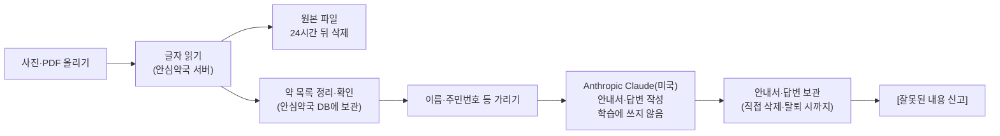

# 안심약국 개인정보 처리방침 (초안)

> 작성 기준: 개인정보보호위원회 「개인정보 처리방침 작성지침」(2026.4. 개정) 본문 Ⅲ장 순서 + 부록 1 「생성형 AI 서비스 처리방침」, 「인공지능 발전과 신뢰 기반 조성 등에 관한 기본법」 제31조
> 상태: 부트캠프 1인 프로젝트용 초안. `[결정 필요]`, `[확인 필요]` 표시는 공개 전에 채우거나 확인해야 할 곳입니다. 법률 검토를 거친 문서가 아닙니다.
> 연결 요구사항: USR-004(동의 이력), USR-006(삭제), SYS-001(원본 24시간 삭제), SYS-005(식별정보 가림), SAF-003(AI 답변 신고), SAF-004(AI 사용 고지)

---

## 알기 쉬운 개인정보 처리방침 (요약)

지침 부록은 정보취약계층도 이해할 수 있도록 쉬운 말로 된 요약과 처리 흐름 그림을 함께 두기를 권장합니다(부록 120쪽).

- **무엇을 하나요?** 처방전·약봉투 사진이나 진료·투약기록 PDF에서 약 정보를 읽어, 식약처·질병관리청 공식 자료를 근거로 복약 안내와 질문 답변을 드립니다. 진단이나 처방을 하지 않습니다.
- **AI를 쓰나요?** 네. 안내서와 답변은 생성형 AI(Anthropic의 Claude)가 공식 자료 안에서 작성합니다. AI가 쓴 글에는 "AI 작성" 표시가 붙습니다.
- **무엇이 밖으로 나가나요?** 이름·주민등록번호·전화번호·병원 등록번호를 지운 약 이름, 먹는 법, 건강상태(임신 여부, 지병 등)만 미국의 Anthropic으로 보냅니다.
- **AI 학습에 쓰나요?** 아니요. 안심약국도, Anthropic도 입력한 정보를 AI 학습에 쓰지 않습니다.
- **얼마나 보관하나요?** 처방 기록·안내서·대화는 직접 지우거나 탈퇴할 때까지 보관합니다. 원본 사진·PDF는 글자를 읽은 뒤 24시간 안에 지웁니다.
- **지우고 싶으면?** 마이페이지 '내 기록'에서 처방 기록이나 대화방을 하나씩 지울 수 있고, 탈퇴하면 모두 지워집니다.
- **AI 답변이 이상하면?** 답변과 안내서마다 있는 [잘못된 내용 신고] 버튼을 눌러 주세요.

---

## 1. 개인정보의 처리 목적

안심약국(이하 "서비스")은 다음 목적으로 개인정보를 처리합니다. 목적이 바뀌면 「개인정보 보호법」 제18조에 따라 별도 동의를 받는 등 필요한 조치를 합니다.

1. **회원 가입·관리:** 가입 의사 확인, 본인 식별, 로그인 유지, 탈퇴 처리
2. **의료 문서 인식:** 이용자가 올린 처방전·약봉투·진료·투약기록에서 약 이름, 복용량, 횟수, 일수, 복용 시점, 진단명, 진료일을 읽어 표로 정리
3. **공식 의약품 정보 연결:** 정리된 약을 식약처 의약품 정보와 연결하고, 공식 주의 문구와 DUR(함께 먹으면 안 되는 약 등) 정보를 보여줌
4. **AI 맞춤 복약·생활 안내:** 생성형 AI가 이용자의 처방 약과 건강상태를 반영해, 공식 자료 안에서 쉬운 말로 복약 방법과 생활 수칙을 작성하고 복약 시간표를 정리
5. **AI 복약 상담:** 이용자의 처방과 건강상태를 기준으로 공식 자료에 근거해 질문에 답하고, 병원·약국 방문 전 물어볼 질문을 만들어 줌
6. **안전·품질 관리:** 부적절한 AI 답변 신고 처리, 오류 확인, 단계별 응답 시간 측정

**AI의 의도된 용례(intended use):** 성인 이용자 본인이 처방받은 약을 이해하도록 돕는 정보 안내입니다. 질병 진단, 처방 변경, 복용 중단 권고, 의료진 상담 대체에는 쓰지 않으며, AI는 그런 질문에 답하지 않고 의사·약사 상담을 안내합니다(부록 121쪽).

## 2. 처리하는 개인정보의 항목

### 2-1. 정보주체의 동의를 받지 않고 처리하는 항목

| 법적 근거 | 처리 목적 | 항목 | 보유·이용 기간 |
|---|---|---|---|
| 제15조 제1항 제4호(계약 체결·이행) | 회원 가입·관리 | 이메일, 비밀번호(암호화), 출생연도 / 선택: 이름, 성별 | 회원 탈퇴 시까지 |
| 제15조 제1항 제4호 | 서비스 이용 중 생성 | 접속 일시, IP 주소(해시), 브라우저 정보, 기능 이용 기록, 단계별 처리 시간 | `[결정 필요]` 예: 생성일로부터 3개월 |

### 2-2. 정보주체의 동의를 받아 처리하는 항목

| 법적 근거 | 처리 목적 | 항목 | 보유·이용 기간 |
|---|---|---|---|
| 제23조 제1항 제1호(민감정보 별도 동의) | 의료 문서 인식, 안내서·상담 | **올린 원본 파일:** 처방전·약봉투 사진, 진료·투약기록 PDF | 글자 읽기 완료 후 24시간 안에 삭제 |
| 제23조 제1항 제1호 | 의료 문서 인식, 안내서·상담 | **정리된 처방 기록:** 약 이름, 보험코드, 복용량·횟수·일수·복용 시점, 진단명·상병코드, 진료·조제일, 병원·약국명(화면 표시만) | 회원 탈퇴 시 또는 이용자가 직접 삭제할 때까지 |
| 제23조 제1항 제1호 | 맞춤 안내 | **건강정보:** 지병, 알레르기, 임신·수유 여부 | 회원 탈퇴 시 또는 이용자가 수정·삭제할 때까지 |
| 제23조 제1항 제1호 | AI 안내·상담 | **입력 정보와 결과물:** 챗봇에 입력한 질문, 선택한 질문 버튼, AI가 작성한 안내서·답변·방문 전 질문, 근거 인용 | 회원 탈퇴 시 또는 이용자가 직접 삭제할 때까지 |
| 제23조 제1항 제1호 | 안전·품질 관리 | **신고 내용:** 신고 사유, 설명(식별정보 가림) | 회원 탈퇴 시까지 |

**입력 주의:** 대화창에 본인이나 다른 사람의 주민등록번호, 전화번호, 병원 등록번호, 이름을 입력하지 마세요. 서비스는 입력된 내용에서 이런 정보를 자동으로 가리지만, 가림이 완벽하지 않을 수 있습니다(부록 122쪽).

## 3. 14세 미만 아동의 개인정보 처리

`[결정 필요]` 예: 서비스는 만 14세 미만 아동의 회원가입을 받지 않습니다. 가입 시 출생연도로 확인합니다.

## 4. 개인정보의 처리 및 보유 기간

| 구분 | 보유 기간 | 삭제 방법 |
|---|---|---|
| 원본 사진·PDF | 글자 읽기 완료 후 24시간 | 예약 작업으로 자동 삭제 |
| 정리된 처방 기록, 안내서, 복약 시간표, 상담 대화, 근거 인용 | 회원 탈퇴 시 또는 이용자가 직접 삭제할 때까지 | 마이페이지 '내 기록'에서 처방 기록·대화방 단위로 즉시 삭제. 처방 기록을 지우면 그 기록으로 만든 안내서·시간표·대화도 함께 삭제 |
| 건강정보 | 회원 탈퇴 시 또는 건강 민감정보 동의를 철회할 때까지 | 마이페이지에서 수정·삭제 |
| 동의 이력 | 회원 탈퇴 시까지 | 탈퇴 시 삭제 |
| 삭제 기록 | `[결정 필요]` | 이용자를 알아볼 수 없는 해시값과 삭제 건수만 남김 |

## 5. 개인정보의 파기 절차 및 방법

보유 기간이 끝났거나 이용자가 삭제를 요청하면 지체 없이 파기합니다. 전자 파일과 DB 기록은 복구할 수 없는 방법으로 삭제합니다. 다른 법령에 따라 보존해야 하는 정보는 없습니다 `[확인 필요]`.

## 6. 개인정보의 제3자 제공

서비스는 이용자의 개인정보를 제3자에게 제공하지 않습니다.

## 7. 개인정보 처리업무의 위탁

| 수탁자 | 위탁 업무 |
|---|---|
| Anthropic, PBC (미국) | 생성형 AI 기반 복약 안내서·상담 답변·방문 전 질문 작성, 질문의 안전 분류, 대화 요약 (Claude API) |
| `[결정 필요]` 배포 서버 업체 | 서비스 서버·DB 운영 |

Anthropic은 상용 API 약관에 따라 전송된 데이터를 자체 AI 모델 학습에 사용하지 않습니다 `[확인 필요: Anthropic 상용 약관·DPA 원문으로 확인 후 기재]` (부록 128쪽).

## 8. 개인정보의 국외 이전

서비스는 생성형 AI 안내·상담을 제공하기 위해 아래와 같이 개인정보를 국외에 이전하며, 「개인정보 보호법」 제28조의8 제2항에 따라 다음과 같이 안내합니다(본문 46쪽, 부록 129쪽).

| 항목 | 내용 |
|---|---|
| 법적 근거 | 「개인정보 보호법」 제28조의8 제1항 제3호(계약 이행을 위한 국외 처리위탁·보관) |
| 이전하는 개인정보 항목 | 이름·주민등록번호·전화번호·병원 등록번호·병원명을 지운 다음 정보: 약 이름과 복용 방법, 공식 주의 문구, 건강상태(나이대, 임신·수유 여부, 지병, 알레르기, 진단명), 이용자가 입력한 질문 |
| 이전 국가 | 미국 |
| 이전 시기 및 방법 | 안내서를 만들거나 질문에 답할 때마다, 인터넷을 통해 암호화(TLS) 전송 |
| 이전받는 자 | Anthropic, PBC (연락처: `[확인 필요: Anthropic 개인정보 문의 주소]`) |
| 이용 목적 | 요청한 안내서·답변의 작성 |
| 보유·이용 기간 | `[확인 필요: Anthropic API 데이터 보관 정책 원문 기준으로 기재]` |
| 거부 방법·절차·효과 | 국외 이전을 거부하면 AI 안내서와 상담을 이용할 수 없습니다. 원하지 않으면 마이페이지 > 회원 탈퇴로 탈퇴하거나 개인정보 보호책임자에게 요청할 수 있습니다. 주의 문구 원문과 DUR 확인, 복약 시간표는 AI를 쓰지 않습니다 `[결정 필요: 거부한 이용자에게 이 기능만 제공할지]` |

## 9. 개인정보의 안전성 확보조치

- **관리적 조치:** 개인정보를 다루는 사람을 운영자 1인으로 한정
- **기술적 조치:**
  - 비밀번호 bcrypt 해시 저장
  - 원본 파일 비공개 저장소 보관
  - 통신 구간 암호화
  - AI 전송 전 식별정보 자동 가림(가린 건수 기록)
  - 접근 기록 보관
- **원본 파일 관리:** 원본 파일은 24시간 뒤 자동 삭제하고 삭제 기록을 남김

## 10. 민감정보의 공개 가능성 및 비공개 선택 방법

서비스는 이용자의 건강정보와 처방 기록을 다른 사람에게 공개하지 않으며, 공개 기능도 두지 않습니다.

## 11. 가명정보 처리

해당 없음. 서비스는 이용자 정보를 가명처리해 연구·AI 학습에 쓰지 않습니다.

## 12. 개인정보 자동 수집 장치

로그인 유지를 위한 쿠키만 사용합니다. 브라우저 설정에서 거부할 수 있으며, 거부하면 로그인이 유지되지 않습니다. 광고·행태정보 수집 도구는 쓰지 않습니다.

## 13. 정보주체의 권리·의무 및 행사 방법 (생성형 AI 항목 포함)

이용자는 언제든 개인정보 열람, 정정, 삭제, 처리 정지, 동의 철회를 요구할 수 있습니다. 마이페이지에서 직접 하거나 개인정보 보호책임자에게 요청하면 지체 없이 조치합니다.

지침 부록 131쪽의 생성형 AI 권리 보장 기재 사항은 다음과 같습니다.

| 기재 사항 | 안심약국 |
|---|---|
| ① AI 모델 학습 활용 여부 | 입력 정보와 결과물을 AI 학습에 쓰지 않습니다. 서비스는 자체 모델을 학습하지 않고, 수탁자(Anthropic)도 학습에 쓰지 않습니다 `[확인 필요]`. |
| ② 개인정보 필터링 정책 | AI로 보내기 전과 DB에 저장하기 전에 이름·주민등록번호·전화번호·병원 등록번호를 자동으로 가립니다. 병원·약국명은 AI로 보내지 않습니다. |
| ③ 학습 거부(Opt-out) 절차 | 학습에 쓰지 않으므로 별도 절차가 없습니다. |
| ④ 부적절한 답변 피드백·신고 | 안내서와 답변마다 있는 [잘못된 내용 신고] 버튼으로 신고합니다(사유: 내용이 틀림, 위험한 권유, 개인정보 노출, 근거와 다름, 기타). 개인정보 노출 신고는 가장 먼저 확인합니다. |
| ⑤ 학습된 데이터의 통제권 한계 | 학습에 쓰지 않으므로 해당 없습니다. 저장된 기록은 언제든 삭제할 수 있습니다. |

## 14. 자동화된 결정

해당 없음. AI 안내서와 답변은 공식 자료를 쉬운 말로 옮긴 참고 정보입니다. 이용자의 권리나 의무에 영향을 주는 결정을 하지 않습니다.

## 15. 개인정보 보호책임자

- **성명:** 신혜원
- **연락처:** `[결정 필요: 이메일]`

## 16. 권익침해 구제 방법

다음 기관에 분쟁 해결이나 상담을 신청할 수 있습니다.

- **개인정보분쟁조정위원회:** 1833-6972
- **개인정보침해 신고센터:** 118
- **대검찰청:** 1301
- **경찰청:** 182

## 17. 처리방침 변경

이 처리방침은 `[시행일]`부터 적용됩니다. 처리 항목, 국외 이전처럼 이용자 권리에 중대한 영향을 주는 변경은 시행 전에 변경 전후 대조표로 알립니다.

---

## 부록. 서비스 화면의 AI 고지·표시 (인공지능기본법 제31조)

처리방침과 별개로 화면에서 지켜야 할 사항입니다. 자세한 위치는 `docs/wireframe_5screens.md`의 `AiNotice`, `AiBadge`, `EXPORT_LABEL`을 참고하세요.

| 조항 | 의무 | 안심약국 적용 |
|---|---|---|
| 제31조 제1항 사전 고지 | 생성형 AI 기반 서비스임을 미리 알림 | 이용약관, 회원가입 화면, 화면 1 업로드 동의 위, 화면 5 대화방 첫 메시지 |
| 제31조 제2항 결과물 표시 | AI가 만든 결과물임을 표시 | 안내서·생활 수칙·챗봇 답변에 "AI 작성" 라벨. 규칙으로 만든 영역(주의 문구 원문, DUR 배지, 시간표)에는 붙이지 않음 |
| 외부 반출 시 표시 | 복사·저장·다운로드한 결과물 자체에 표시 | 방문 전 질문 [복사]·[저장], 안내서 PDF·이미지 저장 시 맨 위에 `EXPORT_LABEL` 자동 삽입 |

보건의료 분야라 '고영향 인공지능' 해당 여부도 과기정통부 「고영향 인공지능 판단 가이드라인」으로 확인해 두세요 `[확인 필요]`. 진단·처방 판단을 하지 않는 정보 안내 서비스라 해당 가능성은 낮아 보입니다.
