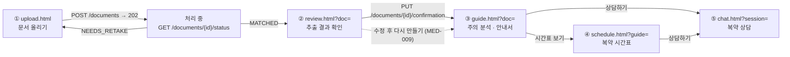

# 안심약국 핵심 5화면 와이어프레임 · 컴포넌트 · API 매핑 명세

> 기준: 요구사항 정의서 겸 계획서(261125) · 구현계획 엑셀 · `infra/db/schema.sql` · `docs/ERD_초안.md` · `docs/review/decision_log_261125.md`
> 261125 수정: 기획 검토 결정 반영. **9장 변경 사항이 각 화면 절보다 우선**하며, 최신 화면 모양은 시연 화면(캔버스 「안심약국 공백 안내 흐름 시연」)을 기준으로 합니다. 시연 페르소나는 만 68세 고혈압 환자 1명(와파린: ○○내과, 쎄레브렉스: △△정형외과, 졸피뎀: 자기 전 0.5정).
> 화면 기술: HTML · CSS · JS(Tailwind CDN) + `fetch` / 백엔드: FastAPI (`app/routers`: auth, documents, drugs, guides, chat)
> LLM: Claude API(개발 Haiku / 시연 Sonnet). 모든 LLM 입력은 식별정보 마스킹 후 전달(SYS-005), 국외 처리위탁은 개인정보 처리방침에 공개
> 법·지침 반영: 「개인정보 처리방침 작성지침」(2026.4.) 생성형 AI 부록, 「인공지능기본법」 제31조(사전 고지·생성물 표시). 신설 요구사항 ID는 `SAF-003`(AI 답변 신고), `SAF-004`(AI 사용 고지·생성물 표시)이며, `USR-006`은 개별 기록 삭제까지 넓혔습니다. 처리방침 초안은 `docs/privacy_policy_draft.md`
> 인증: 12/4 초기 모델은 `get_current_user()`가 고정 사용자 `user_id=1`을 돌려주고, 12/7 이후 JWT(access 30분 / refresh 14일)로 바꿉니다. **API 경로와 응답 형식은 바뀌지 않습니다.**

---

## 0. 공통

### 0-1. 화면 흐름



### 0-2. 공통 컴포넌트

| 컴포넌트 | 위치 | 내용 | 요구사항 |
|---|---|---|---|
| `AppHeader` | 모든 화면 상단 | 로고, 단계 표시(①~⑤), 마이페이지 | — |
| `StepIndicator` | 헤더 아래 | 올리기 → 확인 → 주의·안내 → 시간표 → 상담 | — |
| `DisclaimerFooter` | 화면 3·4·5 하단 **고정** | SAF-001 고정 문구 (아래 0-3) | SAF-001 |
| `EmergencyBanner` | 화면 3 맨 위, 화면 5 응급 감지 시 | SAF-002 고정 문구 + 허가정보 '중지하고 상의' 원문 | SAF-002 |
| `SourceCard` | 근거가 붙는 모든 문장 아래 | 출처명 · 원문 펼치기 · 자료 기준일 | MED-004, DAT-001 |
| `ErrorNotice` | 실패 시 해당 영역 | 오류 코드별 쉬운 안내 + 다음 행동 버튼 (0-4) | SYS-002 |
| `AiNotice` | 화면 1 동의 영역 위, 화면 5 첫 안내 | `AI_NOTICE` 사전 고지 (인공지능기본법 제31조 ①) | SAF-004 |
| `AiBadge` | AI가 쓴 문장 묶음마다 (안내서 섹션, 챗봇 답변) | "AI 작성" 라벨 + 툴팁 `AI_LABEL`. 규칙으로 만든 영역(DUR 배지, 주의 문구 원문, 시간표)에는 붙이지 않음 | SAF-004 |
| `ReportButton` → `ReportSheet` | AI 안내서 하단, 챗봇 답변마다 | [잘못된 내용 신고] → 사유 선택 + 설명(선택) → `REPORT_DONE` | SAF-003 |
| `RecordDeleteButton` | 화면 2·3 상단 메뉴, 화면 5 대화방 메뉴 | [이 기록 삭제] → 확인 대화상자(`DELETE_CONFIRM`) | USR-006 |

글자 크기는 본문 18px 이상, 버튼 높이 48px 이상으로 고령 사용자를 기준으로 잡습니다. 경고 배지는 색만으로 구분하지 않고 항상 글자 라벨을 함께 씁니다.

### 0-3. 고정 문구

| 키 | 문구 | 사용 |
|---|---|---|
| `DISCLAIMER` | 이 내용은 식약처·질병관리청 등 공공기관 자료를 쉬운 말로 옮긴 참고 정보입니다. 진단이나 처방을 대신하지 않으며, 약을 끊거나 양을 바꾸는 일은 반드시 의사·약사와 상의하세요. | `guides.disclaimer`, 모든 챗봇 답변 |
| `EMERGENCY` | 숨쉬기 힘들거나 얼굴·입술·목이 붓거나 온몸에 두드러기가 나면 바로 119에 전화하거나 가까운 응급실로 가세요. | `guides.emergency_notice`, 응급 감지 답변 |
| `NO_WARNING` | 공식 주의 문구 없음 (복용 후 몸 상태를 확인하세요) | MED-005, 주의 문구 0건 |
| `NEED_CHECK` | 확인 필요 – 공식 자료를 불러오지 못했습니다. 약사에게 확인하세요. | MED-005, 자료 조회 실패 |
| `NO_EVIDENCE` | 공식 자료에서 답을 확인하지 못했어요. 약사에게 물어보세요. | CHT-002, `answer_status=NO_EVIDENCE` |
| `REFUSAL` | 약을 끊거나 양·시간을 바꾸는 일은 여기서 답할 수 없어요. 처방한 의사나 약사와 꼭 상의하세요. | CHT-003, `is_refusal=true` |
| `AI_NOTICE` | 안심약국은 생성형 AI(Claude)가 식약처·질병관리청 공식 자료를 바탕으로 복약 안내와 답변을 작성하는 서비스입니다. | SAF-004, 화면 1·5, 이용약관 |
| `AI_LABEL` | AI 작성 – 공식 자료를 근거로 AI가 쉬운 말로 옮겼어요. 원문은 근거 카드에서 확인하세요. | SAF-004, `AiBadge` 툴팁 |
| `EXPORT_LABEL` | [안심약국 · AI 작성] 이 내용은 생성형 AI가 공식 자료를 바탕으로 작성한 참고 정보입니다. | SAF-004, 복사·저장·다운로드 결과물 맨 위에 자동 삽입 |
| `INPUT_CAUTION` | 이름·주민등록번호·전화번호·병원 등록번호는 입력하지 마세요. 입력해도 자동으로 가려집니다. | 개인정보 처리방침 작성지침 부록, 화면 5 입력창 |
| `REPORT_DONE` | 신고가 접수됐어요. 확인 후 고치거나 답변을 드릴게요. 급한 증상이면 119나 가까운 병원으로 가세요. | SAF-003 |
| `DELETE_CONFIRM` | 이 처방 기록과 안내서·시간표·상담 대화를 모두 지울까요? 지운 기록은 되살릴 수 없어요. | USR-006 |

### 0-4. 오류 코드 → 화면 안내 (SYS-002)

실패가 "주의 문구 없음"으로 보이지 않도록 오류는 항상 별도 상태로 표시합니다.

| HTTP | `error_code` | 안내 문구 | 다음 행동 버튼 |
|---|---|---|---|
| 428 | `CONSENT_REQUIRED` | 문서를 읽으려면 처리 동의가 필요해요. | 동의 항목 보기 |
| 413 | `FILE_TOO_LARGE` | 파일이 20MB를 넘어요. | 다른 파일 고르기 |
| 415 | `UNSUPPORTED_TYPE` | JPG, PNG, HEIC, PDF만 올릴 수 있어요. | 다른 파일 고르기 |
| 422 | `PDF_TOO_MANY_PAGES` | PDF는 50쪽까지 읽을 수 있어요. | 다른 파일 고르기 |
| 200 | `OCR_LOW_QUALITY` (`status=NEEDS_RETAKE`) | 글자가 흐려 정확히 읽기 어려워요. 밝은 곳에서 평평하게 다시 찍어 주세요. | 다시 찍기 |
| 502 | `PUBLIC_DATA_UNAVAILABLE` | 공식 약 정보를 불러오지 못했어요. 이 약은 '확인 필요'로 표시했어요. | 다시 시도 |
| 503 | `LLM_UNAVAILABLE` | 안내서를 만드는 중 문제가 생겼어요. 주의 문구는 그대로 볼 수 있어요. | 잠시 뒤 다시 만들기 |
| 409 | `ITEMS_NOT_CONFIRMED` | 노란 표시가 있는 약을 먼저 확인해 주세요. | 해당 줄로 이동 |
| 403 | `HEALTH_CONSENT_REQUIRED` | 건강정보를 저장하려면 건강 민감정보 동의가 필요해요. | 동의하기 |

---

## 화면 1. 문서 올리기 — `upload.html`

**요구사항**: DOC-001, DOC-002, DOC-006, DOC-007, USR-004, SYS-001, SYS-005
**DB**: `consent_logs`, `documents`, `pipeline_metrics`

```
┌──────────────────────────────────────────────────────────────┐
│ 안심약국                              ① ② ③ ④ ⑤    [마이페이지] │
├──────────────────────────────────────────────────────────────┤
│ 어떤 문서를 올리시나요?                                       │
│  ( ● 처방전 )  ( ○ 약봉투 )  ( ○ 진료·투약기록 PDF )          │  DocTypeSelector
│                                                              │
│ ┌──────────────────────────────────────────────────────────┐ │
│ │              여기에 파일을 끌어다 놓거나                   │ │  FileDropzone
│ │        [ 사진 찍기 ]      [ 파일 고르기 ]                  │ │
│ │   JPG·PNG·HEIC·PDF / 20MB 이하 / PDF 50쪽 이하            │ │
│ └──────────────────────────────────────────────────────────┘ │
│  ▣ 처방전_1123.jpg   2.4MB   미리보기 ▢        [ 지우기 ]     │  FilePreview
│                                                              │
│ 촬영 도움말  · 평평한 곳, 밝은 조명  · 글자가 화면을 꽉 채우게   │  CaptureTips
│  (PDF 선택 시) 심평원 「내가 먹는 약! 한눈에」 PDF를 올리면     │  RecordPdfHint
│   과거 약 목록을 불러옵니다. 반영이 최대 3개월 늦을 수 있어요.   │  (DOC-007)
│                                                              │
│ ⓘ 안심약국은 생성형 AI(Claude)가 공식 자료를 바탕으로 복약    │  AiNotice
│   안내와 답변을 작성하는 서비스입니다.                         │  (SAF-004)
│ ── 동의 ──────────────────────────────────────────────────── │  ConsentPanel
│  ☑ [필수] 올린 문서의 글자 읽기·처리에 동의합니다.             │  DOCUMENT_PROCESSING
│       원본 파일은 읽기가 끝나고 24시간 안에 삭제됩니다. [자세히] │
│  ☑ [필수] 건강 민감정보(처방 약·진단명) 수집·이용에 동의합니다. │  HEALTH_SENSITIVE
│       이름·주민번호 등을 지운 약·건강 정보는 안내서 작성을 위해  │
│       AI 처리업체(Anthropic, 미국)로 전송돼요.        [자세히]   │
│  ⚠ 본인의 문서만 올려 주세요.                                  │
│                                                              │
│               [   문서 읽기 시작   ]  (모두 체크 전 비활성)      │  SubmitButton
├──────────────────────────────────────────────────────────────┤
│ 처리 중 ─ ● 올리기  ● 글자 읽기  ○ 표로 정리  ○ 약 찾기        │  ProgressStepper
└──────────────────────────────────────────────────────────────┘
```

### 컴포넌트 명세

| 컴포넌트 | 상태·검증 | 연결 API / DB |
|---|---|---|
| `DocTypeSelector` | `PRESCRIPTION` · `MED_BAG` · `MEDICAL_RECORD_PDF` (PDF 선택 시 `source_track=A_PDF_PARSE`, 그 외 `B_OCR`) | `documents.doc_type`, `source_track` |
| `FileDropzone` | 브라우저에서 1차 검사(확장자·20MB), 서버에서 재검사. `capture="environment"`로 모바일 카메라 | `POST /documents` |
| `ConsentPanel` | 화면 진입 시 현재 동의 상태 조회 → 이미 유효한 항목은 체크된 채 잠금. 새로 체크한 항목만 기록 | `GET /users/me/consents`, `POST /users/me/consents` → `consent_logs` |
| `SubmitButton` | 필수 2개 체크 + 파일 선택 시 활성 | — |
| `ProgressStepper` | 1.5초 간격 폴링. `status`: `UPLOADED → EXTRACTING → EXTRACTED → STRUCTURED → MATCHED` | `GET /documents/{id}/status` |

### API

**① 동의 상태 조회** `GET /users/me/consents`
```json
{ "TERMS": true, "PRIVACY": true, "HEALTH_SENSITIVE": false,
  "DOCUMENT_PROCESSING": false, "terms_version": "v1.0-2026-12-08" }
```
서버: 종류별로 `fn_has_active_consent(user_id, type)`.

**② 동의 기록** `POST /users/me/consents`
```json
// 요청
{ "items": [ {"consent_type": "DOCUMENT_PROCESSING", "action": "AGREE"},
             {"consent_type": "HEALTH_SENSITIVE",    "action": "AGREE"} ],
  "terms_version": "v1.0-2026-12-08", "channel": "UPLOAD" }
// 응답 201
{ "consent_log_ids": { "DOCUMENT_PROCESSING": 41, "HEALTH_SENSITIVE": 42 } }
```

**③ 업로드** `POST /documents` (multipart/form-data)

| 필드 | 값 |
|---|---|
| `file` | 바이너리 |
| `doc_type` | `PRESCRIPTION` |
| `consent_log_id` | `41` (DOCUMENT_PROCESSING 행) |

```json
// 응답 202
{ "document_id": "8f0c…", "status": "UPLOADED", "status_url": "/documents/8f0c…/status" }
```
서버 처리(`services/ocr`): 형식·크기·쪽수 검사 → HEIC는 pillow-heif로 JPG 변환 → 비공개 폴더 저장(`storage_path`) → `file_sha256` 계산 → 백그라운드 작업 시작. PDF는 PyMuPDF로 글자를 먼저 꺼내고(`PDF_TEXT` / 진료기록은 `PDF_TABLE_PARSE`), 글자가 없으면 쪽마다 200dpi 이미지로 바꿔 RapidOCR(`PDF_OCR`). 사진은 `IMAGE_OCR`.

**④ 진행 상태** `GET /documents/{document_id}/status`
```json
{ "document_id": "8f0c…", "status": "NEEDS_RETAKE",
  "quality": { "ocr_avg_confidence": 0.52, "ocr_char_count": 14 },
  "error_code": "OCR_LOW_QUALITY", "next": null }
```
- DOC-006 판정: `ocr_avg_confidence < 0.6` 또는 `ocr_char_count < 20` → `NEEDS_RETAKE` (복원·보정하지 않음)
- `MATCHED`가 되면 `"next": "/review.html?doc=8f0c…"`
- 각 단계 시간은 `pipeline_metrics(stage='UPLOAD'|'PDF_TEXT'|'OCR'|'QUALITY'|'STRUCTURE'|'MATCH')`에 기록 (SYS-003)
- `extracted_at` 기록과 동시에 `purge_after = extracted_at + 24h` (SYS-001, APScheduler가 삭제 후 `deletion_logs`)

---

## 화면 2. 추출 결과 확인·수정 — `review.html?doc={document_id}`

**요구사항**: DOC-003, DOC-004, DOC-005, DOC-007, MED-001, MED-009
**DB**: `documents`, `document_items`, `medicines`(`fn_search_medicines`, `fn_match_by_edi`), `ocr_typo_dictionary`

```
┌──────────────────────────────────────────────────────────────┐
│ 읽은 내용을 확인해 주세요                       ① ❷ ③ ④ ⑤    │
├──────────────────────────────────────────────────────────────┤
│ ┌ 원본 미리보기 ───────┐  처방전 · 진료일 2026-11-26          │  DocumentMeta
│ │ [이미지/PDF 썸네일]  │  병원명은 화면에만 표시하고 안내서     │
│ │  선택 줄 하이라이트   │  작성에는 쓰지 않아요.                 │
│ └─────────────────────┘  진단명: 고혈압(I10)  [수정]           │
│                                                              │
│ 3개 중 1개를 확인해 주세요  ━━━━━━━━━━━░░░░  2/3               │  ReviewSummary
│ ┌────┬────────────────────────┬──────┬────┬────┬──────┬─────┐ │  ItemTable
│ │상태│ 약 이름 (매칭된 제품)   │1회량 │횟수│일수│복용 때│확인 │ │
│ ├────┼────────────────────────┼──────┼────┼────┼──────┼─────┤ │
│ │ ✔  │ 와파린정2밀리그램       │ 1 정 │ 1  │ 7  │식후30분│ ☑  │ │
│ │    │ EDI 일치 · 일치도 1.00  │      │    │    │       │     │ │  MatchBadge
│ ├────┼────────────────────────┼──────┼────┼────┼──────┼─────┤ │
│ │ ✔  │ 쎄레브렉스캡슐200mg     │1 캡슐│ 2  │ 7  │ 식후  │ ☑  │ │
│ ├────┼────────────────────────┼──────┼────┼────┼──────┼─────┤ │
│ │ ⚠  │ [이소트레티논캡슐10___▼]│0.5캡슐│ 1 │ 7  │취침 전│ ☐  │ │  노란 줄
│ │노란 │ 이름 비슷 · 일치도 0.62 │      │    │    │       │     │ │
│ │    │ ┌ 자동완성 ───────────────────────────────┐         │ │  DrugAutocomplete
│ │    │ │ 졸피뎀정10밀리그램  ○○제약 0.90│         │ │
│ │    │ │ 졸피뎀캡슐20밀리그램  ○○제약 0.82│         │ │
│ │    │ └─────────────────────────────────────────┘         │ │
│ │    │ 글자 인식 신뢰도 0.71  · 원문 "이소트레티논캡슐10"    │ │  OcrConfidence
│ └────┴────────────────────────┴──────┴────┴────┴──────┴─────┘ │
│  [ + 빠진 약 직접 추가 ]                                       │
│                                                              │
│ (진료·투약기록 PDF일 때) 과거 약                               │  PastMedsPicker
│  ☐ 아모디핀정5mg  2026-08-02 조제 · 30일  → 지금도 먹고 있으면 체크│  (DOC-007)
│                                                              │
│  약 이름을 누르면 효능·먹는 법·알약 사진을 볼 수 있어요.        │  DrugDetailModal
│                         [ 확인 완료하고 주의사항 보기 ] (비활성) │  ConfirmButton
└──────────────────────────────────────────────────────────────┘
```

### 컴포넌트 명세

| 컴포넌트 | 동작 | 데이터 |
|---|---|---|
| `ItemTable` | `line_no` 순 표시. 숫자 칸은 바로 고칠 수 있는 입력칸(0.5 단위 허용) | `document_items.*` |
| `MatchBadge` | `EDI_EXACT`=초록 "EDI 일치", `NAME_TRGM`=회색 "이름 비슷", `USER_SELECTED`=파랑 "직접 고름", `NONE`=노랑 "못 찾음" + `match_score` | `match_method`, `match_score` |
| 노란 줄 | `needs_review=true` (서버가 `match_score < 0.7` 또는 미매칭일 때 설정, 0.7은 `.env`의 `MATCH_REVIEW_THRESHOLD`) | `needs_review` |
| `OcrConfidence` | 줄 OCR 신뢰도와 원문 표시, 원본 미리보기에서 해당 좌표 하이라이트 | `ocr_confidence`, `raw_text`, `documents.ocr_raw[].bbox` |
| `DrugAutocomplete` | 2글자부터, 250ms 디바운스, 상위 10개. 고르면 `match_method=USER_SELECTED`, `match_score=1.0` | `GET /drugs/search` |
| `PastMedsPicker` | DOC-007 과거 약은 기본 해제, 체크해야 `include_in_analysis=true` | `include_in_analysis`, `dispensed_date` |
| `DrugDetailModal` | 효능·용법(허가 원문 또는 e약은요), 알약 사진 | `GET /drugs/{item_seq}` |
| `ConfirmButton` | 모든 줄 `user_confirmed=true`일 때 활성 | `PUT /documents/{id}/confirmation` |

### API

**① 항목 조회** `GET /documents/{document_id}/items`
```json
{ "document": { "document_id": "8f0c…", "doc_type": "PRESCRIPTION", "visit_date": "2026-11-26",
                "diagnoses": [{"name": "고혈압", "kcd_code": "I10"}], "status": "MATCHED" },
  "items": [
    { "item_id": 103, "line_no": 3, "drug_name": "이소트레티논캡슐10", "raw_text": "이소트레티논캡슐10 0.5 1 7 취침전",
      "ocr_confidence": 0.71, "edi_code": null, "dose_per_time": 0.5, "dose_unit": "캡슐",
      "times_per_day": 1, "total_days": 7, "timing_text": "취침 전",
      "matched_item_seq": "200000004", "matched_item_name": "졸피뎀정10밀리그램",
      "match_method": "NAME_TRGM", "match_score": 0.62,
      "match_candidates": [{"item_seq": "200000004", "item_name": "졸피뎀정10밀리그램", "score": 0.62}],
      "needs_review": true, "user_confirmed": false, "include_in_analysis": true } ] }
```

**② 약 이름 자동완성** `GET /drugs/search?q=이소트레&limit=10`
```sql
SELECT * FROM fn_search_medicines(:q, :limit);   -- 정상 품목만, 정규화 이름 trigram
```
```json
[ { "item_seq": "200000004", "item_name": "졸피뎀정10밀리그램", "entp_name": "○○제약", "score": 0.90 } ]
```
DOC-004 매칭 순서(서버 `services/match`): `fn_match_by_edi(edi_code)` → 없으면 `ocr_typo_dictionary(approved)` 보정 후 `fn_search_medicines` → 함량 숫자 비교로 동명이약 구분 → `match_score` 저장.

**③ 한 줄 수정** `PATCH /documents/{document_id}/items/{item_id}`
```json
{ "matched_item_seq": "200000004", "dose_per_time": 0.5, "times_per_day": 1,
  "total_days": 7, "timing_text": "취침 전", "user_confirmed": true }
```
서버: 이름을 바꿨으면 `is_user_edited=true`, `match_method='USER_SELECTED'`, `match_score=1.0`, `needs_review=false`. 원래 `raw_drug_name`과 다르면 `ocr_typo_dictionary`에 `approved=false` 후보로 추가(`hit_count+1`).

**④ 빠진 약 추가** `POST /documents/{document_id}/items` — 본문은 ③과 같고 `line_no`는 서버가 마지막+1로 채웁니다.

**⑤ 약 상세** `GET /drugs/{item_seq}` → `medicines` 정확 조회 (MED-001, 3초 이내 목표)

**⑥ 확인 완료** `PUT /documents/{document_id}/confirmation`
```json
// 응답 200
{ "status": "CONFIRMED", "confirmed_at": "2026-11-27T10:12:00+09:00",
  "dur_alert_count": 4, "next": "/guide.html?doc=8f0c…" }
// 확인 안 된 줄이 있으면 409 { "error_code": "ITEMS_NOT_CONFIRMED", "item_ids": [103] }
```
서버: `documents.status='CONFIRMED'` → `drug_warnings`가 없는 약은 허가 XML 분류 실행 → `SELECT fn_refresh_dur_alerts(:document_id)`. 이미 안내서가 있던 문서를 고친 경우 `cache_key`가 달라지므로 화면 3에서 [다시 만들기]가 표시됩니다(MED-009).

---

## 화면 3. 주의 분석 · 맞춤 안내서 — `guide.html?doc={document_id}`

**요구사항**: MED-001~006, MED-008, MED-009, SAF-001, SAF-002, SYS-005, DAT-001 (DUR 배지: `dur_rules` 활용, MED-010 선택 기능의 1차 범위)
**DB**: `dur_alerts`+`dur_rules`, `drug_warnings`, `guides`, `evidence_citations`, `kb_chunks`, `user_profiles`, `data_versions`, `guide_feedback`

```
┌──────────────────────────────────────────────────────────────┐
│ 내 약 주의사항과 안내서                         ① ② ❸ ④ ⑤    │
├──────────────────────────────────────────────────────────────┤
│ ┃ 응급 안내                                                  │  EmergencyBanner
│ ┃ 숨쉬기 힘들거나 얼굴·입술이 부으면 바로 119 또는 응급실.      │  (SAF-002 고정)
│ ┃ 쎄레브렉스: "…증상이 나타나면 투여를 중지하고 의사와 상의" [원문]│  is_emergency 문구
├──────────────────────────────────────────────────────────────┤
│ 공식 DUR 확인 결과                         자료 기준 2026.6 고시│  DurAlertPanel
│ ┌──────────────────────────────────────────────────────────┐ │
│ │ [함께 복용 금기]  와파린정2mg  +  쎄레브렉스캡슐200mg      │ │  DurBadge (빨강)
│ │  공식 내용: "출혈 위험 증가"                    [원문 보기]│ │
│ │  → 두 약을 처방한 의사·약사에게 함께 먹어도 되는지 물어보세요.│ │
│ ├──────────────────────────────────────────────────────────┤ │
│ │ [노인 주의]  졸피뎀정10mg   (68세, 출생연도 기준)            │ │  DurBadge (주황)
│ │ [고령자 주의] 와파린정2mg            (만 68세)             │ │  DurBadge (주황)
│ │ [연령 주의]  졸피뎀 – 기준 "12세 미만"              │ │  AGE_CHECK: 나이가
│ └──────────────────────────────────────────────────────────┘ │  기준에 해당할 때만
│  ※ 위험 정도를 계산하지 않고 공식 문구를 그대로 보여드려요.     │
├──────────────────────────────────────────────────────────────┤
│ 약별 주의사항        [와파린] [쎄레브렉스] [졸피뎀]     │  DrugTabs
│  ▸ 임신·수유·고령자   (건강정보와 관련 있어 위로 올림)          │  WarningTypeAccordion
│     "임부 또는 임신하고 있을 가능성이 있는 여성에는…"   [출처] │  (6유형, 정렬만)
│  ▸ 먹으면 안 되는 경우            3                          │
│  ▸ 신중히 먹어야 하는 경우        5                          │
│  ▸ 주요 부작용                    8                          │
│  ▸ 일상생활 주의 [졸음] [음주]    2                          │  life_flags 칩
│  ▸ 함께 먹는 약·음식              4                          │
│  (0건 유형) 공식 주의 문구 없음 (복용 후 몸 상태를 확인하세요)  │  MED-005
├──────────────────────────────────────────────────────────────┤
│ 맞춤 안내서  [AI 작성 ⓘ]           만든 날 11-30 · v1           │  GuidePanel + AiBadge
│  복용 방법                                                   │
│   · 와파린정: 하루 1번, 한 번에 1정, 아침 식사 30분 뒤 [1]     │  근거 번호
│   · 양 조절이 필요한 약은 의사·약사와 상의하세요. [2]          │
│  생활 수칙 (고혈압)                                          │
│   · 짜게 먹지 않도록 … [3]                                    │
│  병원·약국에 물어볼 것                                        │
│   · 와파린과 쎄레브렉스를 함께 먹어도 되는지 확인해 주세요.     │
│ ┌ 근거 ────────────────────────────────────────────────────┐ │  SourceCard 목록
│ │[1] 식약처 의약품 제품 허가정보 – 와파린정 · 용법용량 · 기준일 │ │
│ │[3] 질병관리청 국가건강정보포털 – 고혈압 생활수칙 [링크]       │ │
│ └──────────────────────────────────────────────────────────┘ │
│  이 안내가 도움이 되었나요?  [ 👍 ] [ 👎 ]  [잘못된 내용 신고]   │  FeedbackButtons
│                                                              │  ReportButton (SAF-003)
│  [ 다시 만들기 ]  [ 복약 시간표 보기 ]  [ 이 약으로 상담하기 ]  │
├──────────────────────────────────────────────────────────────┤
│ 이 내용은 공공기관 자료를 쉬운 말로 옮긴 참고 정보입니다 …      │  DisclaimerFooter
└──────────────────────────────────────────────────────────────┘
```

### 컴포넌트 명세

| 컴포넌트 | 규칙 | 데이터 |
|---|---|---|
| `EmergencyBanner` | 고정 문구 + 처방 약의 `drug_warnings.is_emergency=true` 원문을 맨 위에 | `guides.emergency_notice`, `drug_warnings` |
| `DurBadge` | 라벨: `CONCOMITANT`=함께 복용 금기, `PREGNANCY`=임부 금기, `ELDERLY`=고령자 주의, `AGE`=연령 주의, 그 외 `dur_type` 원문. 나이 판단은 서버(`AGE_MATCHED`·`AGE_CHECK_NEEDED`)가 하며 화면은 결과만 표시(F-03) | `dur_alerts` ⨝ `dur_rules` |
| `DurAlertPanel` 빈 상태 | 0건이면 "공식 DUR 목록에서 확인된 항목이 없어요" + `NO_WARNING` 보조 문구. 성분코드 연결이 안 된 약은 "DUR 확인 필요"로 따로 표시 | `v_item_ingredients` 미연결 여부 |
| `WarningTypeAccordion` | 6유형 고정 순서. 건강정보와 맞는 유형(임신·수유 → `SPECIAL_POP`)만 위로 정렬, 결론 문장 없음 | `drug_warnings.warning_type` |
| `GuidePanel` | `sections`의 문장마다 `refs` 번호. 근거 없는 문장은 서버에서 제거된 상태로 도착 | `guides.sections`, `evidence_citations` |
| `SourceCard` | 출처명 · 원문(`quoted_text`) 펼치기 · `base_date` | `evidence_citations` |
| `FeedbackButtons` | 한 번 누르면 선택 상태 유지, 다시 누르면 변경 | `guide_feedback` |
| `AiBadge` | 안내서 제목 옆. 주의 분석 영역(DUR 배지·6유형 원문)에는 붙이지 않음 | SAF-004 |
| `ReportButton` | 사유: `WRONG_INFO` 내용이 틀림 / `UNSAFE_ADVICE` 위험한 권유 / `PRIVACY_EXPOSURE` 개인정보 노출 / `NO_SOURCE` 근거와 다름 / `OTHER` | `POST /guides/{id}/reports` → `ai_output_reports` |
| [다운로드·인쇄] | 안내서를 PDF·이미지로 저장할 때 결과물 맨 위에 `EXPORT_LABEL` 삽입 (인공지능기본법 제31조 ②, 외부 반출) | 화면 렌더링 |
| [다시 만들기] | 확인 화면에서 수정해 `cache_key`가 바뀌었거나 `status='STALE'`일 때 강조 | `POST /guides/{id}/regenerate` |

### API

**① 주의 분석** `GET /documents/{document_id}/analysis` (DB 조회만, LLM 없음 → 3초 이내)
```json
{ "profile_flags": { "pregnancy_status": "NONE", "is_breastfeeding": false, "age_band": "60대", "is_65_or_over": true,
                     "chronic_conditions": ["고혈압"] },
  "dur_alerts": [
    { "alert_id": 1, "dur_type": "CONCOMITANT", "badge": "함께 복용 금기",
      "trigger_reason": "PAIR_IN_DOCUMENT",
      "items": [{"item_id": 101, "name": "와파린정2밀리그램"}, {"item_id": 102, "name": "쎄레브렉스캡슐200밀리그램"}],
      "rule": { "dur_rule_id": 5521, "ingr_name_a": "와파린", "ingr_name_b": "세레콕시브",
                "grade": "1", "prohibition_content": "출혈 위험 증가" },
      "source": { "source_name": "DUR 성분단위 정보", "base_label": "2026.6 고시" } } ],
  "dur_unlinked_item_ids": [],
  "warnings_by_item": [
    { "item_seq": "200000004", "item_name": "졸피뎀정10밀리그램",
      "status": "OK",
      "types": [ { "warning_type": "SPECIAL_POP", "label": "임신·수유·고령자", "pinned": true,
                   "sentences": [{ "warning_id": 9001, "article_title": "임부 및 수유부에 대한 투여",
                                   "sentence": "…", "life_flags": [] }] },
                 { "warning_type": "DAILY_LIFE", "label": "일상생활 주의", "pinned": false, "sentences": [] } ],
      "source": { "source_name": "식약처 의약품 제품 허가정보", "base_date": "2026-11-20" } } ] }
```
- `status`: `OK` / `NO_WARNING`(0건, MED-005) / `NEED_CHECK`(자료 조회 실패)
- 쿼리: `dur_alerts`·`dur_rules` 조인, `drug_warnings WHERE item_seq = ANY(:confirmed_item_seqs)`, `data_versions WHERE is_current`

**② 안내서 생성·조회** `POST /documents/{document_id}/guides`
```json
// 같은 조건 READY가 있으면 200 (MED-008 즉시 재조회)
{ "guide_id": "c2d1…", "status": "READY", "cached": true }
// 없으면 202 → GET /guides/{guide_id} 폴링
{ "guide_id": "c2d1…", "status": "GENERATING", "cached": false }
```
서버(`services/rag` → `services/llm` → `services/safety`):
1. `cache_key = sha256(확인된 item_seq·용법 목록 + user_profiles 값 + 진단명 + data_versions 현재 ID)` → `uq_guides_user_cache_ready` 조회
2. 근거 모으기: 처방 약 3~6개의 허가 원문·`drug_warnings` **정확 조회** + 진단명·지병으로 `fn_kb_search(:query_vec, 3, :diseases)` (12/10부터, 그 전엔 정확 조회만)
3. SYS-005: 이름·주민번호·병원등록번호·전화번호 정규식 마스킹, `hospital_name` 제외 → `input_snapshot`에 비식별본만 저장, 가린 건수는 `pii_mask_counts`
4. Claude Haiku(개발)/Sonnet(시연) 호출: 근거 번호를 단 문장만, 숫자 유지, "증상에 따라 증감" → "양 조절은 의사·약사와 상의"
5. SAF-001 검사: 근거 번호 없는 문장 제거(`removed_unsupported`), "안전합니다 / 먹어도 됩니다 / 끊으세요" 등 단정·지시 표현 제거 또는 재생성(`removed_assertive`)
6. `guides` + `evidence_citations` 저장, `pipeline_metrics(stage='RAG_SEARCH'|'LLM_GUIDE'|'SAFETY_CHECK')`

**③ 안내서 조회** `GET /guides/{guide_id}`
```json
{ "guide_id": "c2d1…", "status": "READY", "created_at": "2026-11-30T14:02:00+09:00",
  "llm_model": "claude-haiku-…", "prompt_version": "guide-v1",
  "emergency_notice": "숨쉬기 힘들거나 …", "disclaimer": "이 내용은 …",
  "sections": {
    "how_to_take":      [ {"text": "와파린정: 하루 1번, 한 번에 1정, 아침 식사 30분 뒤", "refs": [1]} ],
    "life_rules":       [ {"text": "짜게 먹지 않도록 …", "refs": [3]} ],
    "ask_professional": [ {"text": "와파린과 쎄레브렉스를 함께 먹어도 되는지 확인해 주세요.", "refs": [4]} ] },
  "citations": [
    { "ref_no": 1, "source_kind": "MEDICINE_TEXT", "source_title": "식약처 의약품 제품 허가정보 – 와파린정2밀리그램",
      "quoted_text": "…", "base_date": "2026-11-20", "source_url": null },
    { "ref_no": 3, "source_kind": "KB_CHUNK", "source_title": "질병관리청 국가건강정보포털 – 고혈압",
      "quoted_text": "…", "base_date": "2026-11-30", "source_url": "https://health.kdca.go.kr/…" } ],
  "feedback": { "my_rating": null },
  "is_stale": false }
```

**④ 평가** `POST /guides/{guide_id}/feedback` `{ "rating": 1 }` → `guide_feedback` UPSERT (`uq_guide_feedback`)

**⑤ 다시 만들기** `POST /guides/{guide_id}/regenerate` → 새 `guide_id`(`regenerated_from`=이전 ID), 이전 행은 `STALE`, `202`

---

## 화면 4. 복약 시간표 · 생활 수칙 — `schedule.html?guide={guide_id}`

**요구사항**: MED-007, MED-006(생활 수칙), MED-013(선택 TTS), MED-014(선택 알림)
**DB**: `medication_schedules`, `document_items`, `guides.sections.life_rules`, `evidence_citations`

```
┌──────────────────────────────────────────────────────────────┐
│ 하루 복약 시간표                                ① ② ③ ❹ ⑤    │
│ 기간 11-26 ~ 12-02 (7일)                 [ 🔊 읽어 주기 ] (선택)│  PeriodBar / TtsButton
├──────────────────────────────────────────────────────────────┤
│ 아침 ───────────────────────────────────────────────────────  │  TimelineSlot
│   ◉ 와파린정2mg        1정    식후 30분                        │  ScheduleChip
│   ◉ 쎄레브렉스캡슐200mg 1캡슐  식후                            │
│ 점심 ───────────────────────────────────────────────────────  │
│   (이 시간에 먹는 약이 없어요)                                  │
│ 저녁 ───────────────────────────────────────────────────────  │
│   ◉ 쎄레브렉스캡슐200mg 1캡슐  식후                            │
│ 자기 전 ────────────────────────────────────────────────────  │
│   ◉ 졸피뎀정10mg 0.5캡슐                              │
│ 필요할 때 ──────────────────────────────────────────────────  │
│   (없음)                                                      │
│                                                              │
│  처방에 적힌 횟수와 복용 표시만 옮겼어요. 정확한 시각은         │  ScheduleNotice
│  처방한 의사·약사의 안내를 따르세요.                            │
│  ⓘ 복용 표시가 없는 약: 시간을 정하지 않고 '확인 필요'로 둡니다. │
├──────────────────────────────────────────────────────────────┤
│ 생활 수칙  [AI 작성 ⓘ]   (위 시간표는 처방 원문 그대로, AI 미사용) │  LifeRulesList + AiBadge
│  · 고혈압: 짜게 먹지 않도록 … [3]                              │
│  · 와파린정: 술은 … (일상생활 주의 원문) [5]                    │
│ ┌ 근거 ─ [3] 질병관리청 고혈압 · 기준일 11-30 [링크] ─────────┐ │
├──────────────────────────────────────────────────────────────┤
│ [ 안내서로 돌아가기 ]                     [ 이 약으로 상담하기 ] │
│ 이 내용은 공공기관 자료를 쉬운 말로 옮긴 참고 정보입니다 …      │  DisclaimerFooter
└──────────────────────────────────────────────────────────────┘
```

### 칸 배치 규칙 (`services/schedule`, LLM 미사용 · 시각을 새로 만들지 않음)

| 조건 (`document_items`) | 배치 `slot` | `mapping_rule` |
|---|---|---|
| `timing_text`에 "취침" / "자기 전" | `BEDTIME` | `BEDTIME_TEXT` |
| `timing_text`에 "필요시" / "아플 때" | `AS_NEEDED` | `AS_NEEDED_TEXT` |
| `times_per_day = 1` | `MORNING` | `TIMES_1` |
| `times_per_day = 2` | `MORNING`, `DINNER` | `TIMES_2` |
| `times_per_day = 3` | `MORNING`, `LUNCH`, `DINNER` | `TIMES_3` |
| `times_per_day = 4` | `MORNING`, `LUNCH`, `DINNER`, `BEDTIME` | `TIMES_4` |
| 그 외·값 없음 | 배치하지 않고 '확인 필요' | — |

`meal_relation`·`offset_minutes`는 `timing_text`에 있을 때만 채웁니다("식후 30분" → `AFTER_MEAL`, 30). `start_date`는 `dispensed_date` 또는 `documents.visit_date`, `end_date = start_date + total_days - 1`.

### API

**① 시간표 조회** `GET /guides/{guide_id}/schedule`
```json
{ "period": { "start_date": "2026-11-26", "end_date": "2026-12-02" },
  "slots": {
    "MORNING":   [ { "schedule_id": 1, "item_id": 101, "drug_name": "와파린정2밀리그램", "dose_label": "1정",
                     "meal_relation": "AFTER_MEAL", "offset_minutes": 30, "source_text": "식후 30분" } ],
    "LUNCH":     [],
    "DINNER":    [ … ],
    "BEDTIME":   [ … ],
    "AS_NEEDED": [] },
  "unscheduled": [ { "item_id": 104, "drug_name": "…", "reason": "복용 표시 없음" } ],
  "life_rules": [ { "text": "짜게 먹지 않도록 …", "refs": [3] } ],
  "citations": [ … ] }
```
`medication_schedules`가 없거나 `document_items`가 바뀌었으면 서버가 위 규칙으로 다시 만든 뒤(`DELETE … WHERE document_id` → `INSERT`) 응답합니다(MED-009).

**② (선택) 읽어 주기** — 서버 호출 없음. `window.speechSynthesis`(ko-KR)로 `guides.content_md` 읽기, 속도 0.8 / 1.0 / 1.2 (MED-013)

---

## 화면 5. 근거 기반 복약 상담 챗봇 — `chat.html?session={session_id}`

**요구사항**: CHT-001~004, SAF-001, SAF-002, SYS-005, MED-004
**DB**: `chat_sessions`, `chat_messages`, `chat_preset_questions`, `evidence_citations`, `kb_chunks`, `drug_warnings`, `user_profiles`

```
┌──────────────────────────────────────────────────────────────┐
│ 복약 상담                                       ① ② ③ ④ ❺    │
├───────────────┬──────────────────────────────────────────────┤
│ 상담 기준      │  안녕하세요. 11-26 처방 약 3개와 등록하신      │  ContextPanel
│ ─────────────  │  건강정보를 기준으로 공식 자료에서 답해 드려요.│  / ChatThread
│ 약             │                                              │
│ · 와파린정      │  자주 묻는 질문                                │  PresetChips
│ · 쎄레브렉스    │  [이 약은 언제, 어떻게 먹나요?]                 │  (GENERAL)
│ · 졸피뎀│  [술을 마셔도 되는지 공식 자료에는?]            │
│ 건강정보        │  [어떤 증상이면 상담해야 하나요?]               │
│ · 68세(출생연도) │  [제 질환 생활 수칙]                           │
│ · 고혈압        │  [약을 끊거나 반만 먹어도 되나요?]  ← BOUNDARY  │
│ · 만 68세       │                                              │
│ [건강정보 수정] │ ┌ 나 ──────────────────────────────────────┐ │
│               │ │ 약을 끊거나 반만 먹어도 되나요?            │ │
│ 이전 대화 요약  │ └──────────────────────────────────────────┘ │
│ (10번 넘으면)   │ ┌ 안심약국 ─────────────────── [안전 안내] ┐ │  RefusalCard
│               │ │ 약을 끊거나 양·시간을 바꾸는 일은 여기서    │ │
│               │ │ 답할 수 없어요. 처방한 의사나 약사와 꼭     │ │
│               │ │ 상의하세요.                                │ │
│               │ │ [병원·약국에 물어볼 질문 만들기]            │ │
│               │ └──────────────────────────────────────────┘ │
│               │ ┌ 안심약국 [AI 작성 ⓘ] ────────────────────┐ │  AnswerBubble + AiBadge
│               │ │ 와파린정 허가정보의 '일상생활 주의'에는 …   │ │
│               │ │ 라고 나와 있어요. [1]                      │ │
│               │ │ ┌ 근거 [1] 식약처 허가정보 – 와파린정 ┐    │ │  SourceCard
│               │ │ └ 기준일 2026-11-20 · 원문 펼치기    ┘    │ │
│               │ │ 이어서 물어보기: [졸음 주의도 있나요?]      │ │  FollowUpChips
│               │ │ ─ 참고 정보이며 진단·처방을 대신하지 않아요 │ │  DisclaimerInline
│               │ │                         [잘못된 내용 신고]  │ │  ReportButton (SAF-003)
│               │ └──────────────────────────────────────────┘ │
│               │                                              │
│               │ 방문 전 질문 만들기                            │  SituationChips
│               │ [속이 불편해요][다른 병원 약도 먹어요]          │  (CHT-004)
│               │ [약 먹는 걸 잊었어요][임신·수유 중이에요]       │
│               ├──────────────────────────────────────────────┤
│               │ ⚠ 이름·주민번호·전화번호는 입력하지 마세요      │  InputCaution
│               │ [ 직접 질문 입력…                    ] [보내기]│  ChatInput (12/9~)
└───────────────┴──────────────────────────────────────────────┘
│ 이 내용은 공공기관 자료를 쉬운 말로 옮긴 참고 정보입니다 …        │  DisclaimerFooter
└──────────────────────────────────────────────────────────────┘
```

### 컴포넌트 명세

| 컴포넌트 | 동작 | 데이터 |
|---|---|---|
| `ContextPanel` | 대화방 생성 시점 스냅샷(비식별) 표시. 병원명·이름은 없음 | `chat_sessions.context_snapshot`, `summary` |
| `PresetChips` | 세션의 `recommended_presets` 순서대로. 경계 질문(BND-)도 일부 포함해 안전 거절을 보여줌 | `chat_preset_questions` |
| `AnswerBubble` | `answer_status`별: `ANSWERED` 본문+근거 / `NO_EVIDENCE` 고정 문구 / `EMERGENCY` `EmergencyBanner` / `ERROR` `ErrorNotice` | `chat_messages` |
| `RefusalCard` | `is_refusal=true`. LLM 답변 없이 고정 문구 + 방문 전 질문 버튼 | `safety_label='BOUNDARY'` |
| `SourceCard` | 답변 `ref_no`별 원문·출처·기준일 | `evidence_citations(message_id)` |
| `FollowUpChips` | 서버가 고른 후속 질문 | `chat_messages.follow_up_presets` |
| `SituationChips` → `VisitQuestionList` | 질문 3~5개, [복사] [저장] 버튼. 답이나 대체 약은 쓰지 않음 | `chat_messages.visit_questions` |
| `ChatInput` | 12/4 초기 모델은 숨김(버튼만), 12/9부터 표시. 보내기 전 식별정보 가림. 입력창 위에 `INPUT_CAUTION` 상시 표시 | `input_mode='FREE_TEXT'`, `pii_mask_counts` |
| `AiBadge` | 대화방 첫 메시지에 `AI_NOTICE`, 이후 모든 AI 답변 머리에 라벨. 고정 문구로 된 거절·응급 카드에는 붙이지 않음 | SAF-004 |
| `ReportButton` | 답변마다. 사유는 화면 3과 같음 | `POST /chat/messages/{message_id}/reports` → `ai_output_reports` |
| `VisitQuestionList` [복사]·[저장] | 복사·저장되는 텍스트 맨 위에 `EXPORT_LABEL` 자동 삽입 | SAF-004 |
| `DisclaimerInline` | 모든 AI 답변 하단 고정 | `disclaimer_shown=true` |

### API

**① 대화방 만들기** `POST /chat/sessions`
```json
// 요청
{ "document_id": "8f0c…", "guide_id": "c2d1…" }
// 응답 201
{ "session_id": "7a9e…",
  "context": { "items": [{"item_seq": "200000003", "name": "와파린정2밀리그램"}, …],
               "profile_flags": {"pregnancy_status": "NONE", "age_band": "60대", "is_65_or_over": true, "chronic_conditions": ["고혈압"]},
               "diagnoses": ["고혈압"] },
  "presets": [ {"preset_code": "GEN-HOWTO", "category": "GENERAL", "question_text": "이 약은 언제, 어떻게 먹어야 하나요?"},
               {"preset_code": "GEN-ALCOHOL", …}, {"preset_code": "GEN-PREG", …},
               {"preset_code": "BND-STOP", "category": "BOUNDARY", …} ],
  "situations": [ {"preset_code": "SIT-STOMACH", "question_text": "약을 먹고 속이 불편해요"}, … ] }
```
추천 규칙(CHT-001, LLM 미사용): `chat_preset_questions.show_when`을 처방 약의 `drug_warnings.life_flags`(ALCOHOL·DROWSY), `user_profiles`(임신·수유), 진단명 유무와 대조.

**② 메시지 목록** `GET /chat/sessions/{session_id}/messages?before={message_id}&limit=30`

**③ 질문 보내기** `POST /chat/sessions/{session_id}/messages`
```json
// 버튼 질문
{ "input_mode": "PRESET", "preset_code": "GEN-ALCOHOL" }
// 직접 입력 (12/9~)
{ "input_mode": "FREE_TEXT", "content": "와파린 먹는 중에 술 마셔도 돼요?" }
```
```json
// 응답 200 (일반)
{ "user_message_id": 501,
  "assistant": { "message_id": 502, "answer_status": "ANSWERED", "safety_label": "SAFE",
                 "content": "와파린정 허가정보의 '일상생활 주의'에는 … [1]",
                 "citations": [ {"ref_no": 1, "source_kind": "DRUG_WARNING", "source_title": "식약처 의약품 제품 허가정보 – 와파린정2밀리그램",
                                 "quoted_text": "…", "base_date": "2026-11-20"} ],
                 "follow_up_presets": ["GEN-DROWSY", "GEN-SIDEEFF"],
                 "disclaimer": "이 내용은 …" } }
// 응답 200 (경계 질문)
{ "user_message_id": 503,
  "assistant": { "message_id": 504, "answer_status": "REFUSED", "safety_label": "BOUNDARY",
                 "is_refusal": true, "safety_rule_hit": "RULE_STOP_DRUG",
                 "content": "약을 끊거나 양·시간을 바꾸는 일은 여기서 답할 수 없어요. …",
                 "citations": [], "follow_up_presets": ["SIT-STOMACH"] } }
```
서버 처리 순서(`services/safety` → `services/rag` → `services/llm`):
1. SYS-005 식별정보 마스킹 후 `chat_messages`(USER) 저장, 가린 건수는 `pii_mask_counts`
2. CHT-003 1차 규칙(끊기·줄이기·두 배·대체 약·시간 변경·진단 요청 키워드/정규식) → 걸리면 즉시 `REFUSED`, LLM 호출 없음
3. 2차 Haiku 분류(`SAFE`/`BOUNDARY`/`EMERGENCY`) → `EMERGENCY`면 SAF-002 고정 안내
4. `SAFE`: 처방 약 원문·`drug_warnings` 정확 조회 + `fn_kb_search` 상위 3개 → 컨텍스트는 `summary` + 최근 6개 메시지만
5. 근거가 없으면 `NO_EVIDENCE` 고정 문구 (지어내지 않음)
6. SAF-001 출력 검사 후 저장, `evidence_citations(message_id)` 기록, `pipeline_metrics(stage='CHAT_ANSWER')`
7. `chat_sessions.message_count > 10`이면 요약 작업 실행 → `summary`, `summarized_upto_msg_id` 갱신 (12/9)

**④ 방문 전 질문 만들기** `POST /chat/sessions/{session_id}/visit-questions`
```json
// 요청
{ "situation_code": "SIT-OTHERHOSP" }
// 응답 200
{ "message_id": 510,
  "visit_questions": [
    "다른 병원에서 받은 혈압약도 먹고 있는데 지금 약과 함께 먹어도 괜찮은지 확인해 주세요.",
    "와파린을 먹는 동안 피해야 할 약이나 음식이 있는지 알려 주세요.",
    "졸피뎀을 먹는 동안 운전해도 되는지 확인해 주세요." ],
  "disclaimer": "이 내용은 …" }
```
생성 후 답변형 문장("~하세요", "~드세요")이 섞이면 제거하고 질문 3~5개만 남깁니다(CHT-004).

---

## 공통 API. AI 답변 신고 · 기록 삭제

**① 신고** `POST /guides/{guide_id}/reports` · `POST /chat/messages/{message_id}/reports` (SAF-003)
```json
// 요청
{ "reason_code": "WRONG_INFO", "detail": "하루 2번인데 1번으로 나와요" }
// 응답 201
{ "report_id": 17, "status": "RECEIVED" }
```
`detail`도 저장 전에 식별정보를 가립니다. `PRIVACY_EXPOSURE` 신고는 운영자 확인 목록 맨 위로 올립니다. 신고 목록은 QAT-001 안전성 검증 자료로 그대로 씁니다.

**② 처방 기록 하나 삭제** `DELETE /documents/{document_id}` (USR-006)
```json
// 응답 200
{ "deleted": { "documents": 1, "document_items": 3, "guides": 2, "chat_sessions": 1 } }
```
서버: `SELECT fn_delete_document(:user_id, :document_id)` → 반환된 원본 경로가 남아 있으면 파일 삭제. 이 문서에 연결된 안내서·시간표·DUR 결과·대화방이 함께 지워지고 `deletion_logs(kind='USER_DELETE_RECORD')`에 건수만 남습니다.

**③ 대화방 하나 삭제** `DELETE /chat/sessions/{session_id}` (USR-006) → 메시지·근거·신고가 함께 삭제됩니다.

**④ 내 기록 목록** `GET /users/me/records` → 처방 기록별 날짜·약 개수·안내서·대화방 수. 마이페이지 '내 기록'에서 개별 삭제 버튼을 둡니다.

**보관 원칙 (개인정보 처리방침과 동일):** 정리된 처방 기록·안내서·시간표·대화는 회원 탈퇴 시 또는 이용자가 직접 삭제할 때까지 보관합니다. 원본 사진·PDF는 읽기 완료 후 24시간 안에 삭제합니다(SYS-001).

---

## 부록 A. 화면 × API × 테이블 × 요구사항 매트릭스

| 화면 | 메서드 · 경로 | 라우터 | 주요 테이블 / 함수 | 요구사항 | 목표 시간 |
|---|---|---|---|---|---|
| 1 | GET `/users/me/consents` | auth | `fn_has_active_consent` | USR-004 | 3초 |
| 1 | POST `/users/me/consents` | auth | `consent_logs` | USR-004 | 3초 |
| 1 | POST `/documents` | documents | `documents` | DOC-001·007 | 업로드 즉시 202 |
| 1 | GET `/documents/{id}/status` | documents | `documents`, `pipeline_metrics` | DOC-002·006, SYS-003 | 폴링 |
| 2 | GET `/documents/{id}/items` | documents | `document_items` ⨝ `medicines` | DOC-003·005 | 3초 |
| 2 | GET `/drugs/search` | drugs | `fn_search_medicines` | DOC-004·005 | 0.5초 |
| 2 | GET `/drugs/{item_seq}` | drugs | `medicines` | MED-001 | 3초 |
| 2 | PATCH `/documents/{id}/items/{item_id}` | documents | `document_items`, `ocr_typo_dictionary` | DOC-005, MED-009 | 3초 |
| 2 | POST `/documents/{id}/items` | documents | `document_items` | DOC-005 | 3초 |
| 2 | PUT `/documents/{id}/confirmation` | documents | `documents`, `drug_warnings`, `fn_refresh_dur_alerts` | DOC-005 | 3초 |
| 3 | GET `/documents/{id}/analysis` | documents | `dur_alerts`, `dur_rules`, `drug_warnings`, `data_versions` | MED-002~005, DAT-001 | 3초 |
| 3 | POST `/documents/{id}/guides` | guides | `guides`, `fn_kb_search`, `evidence_citations` | MED-006·008, SAF-001·002, SYS-005 | 캐시 3초 / 생성 별도 |
| 3 | GET `/guides/{id}` | guides | `guides`, `evidence_citations` | MED-004·006 | 3초 |
| 3 | POST `/guides/{id}/feedback` | guides | `guide_feedback` | MED-008 | 3초 |
| 3 | POST `/guides/{id}/regenerate` | guides | `guides` | MED-009 | 202 |
| 4 | GET `/guides/{id}/schedule` | guides | `medication_schedules`, `document_items` | MED-007 | 3초 |
| 5 | POST `/chat/sessions` | chat | `chat_sessions`, `chat_preset_questions` | CHT-001 | 3초 |
| 5 | GET `/chat/sessions/{id}/messages` | chat | `chat_messages`, `evidence_citations` | CHT-001 | 3초 |
| 5 | POST `/chat/sessions/{id}/messages` | chat | `chat_messages`, `evidence_citations`, `fn_kb_search` | CHT-002·003, SAF-001·002 | 거절 즉시 |
| 5 | POST `/chat/sessions/{id}/visit-questions` | chat | `chat_messages.visit_questions` | CHT-004 | — |
| 공통 | GET·PATCH `/users/me/health` | auth | `user_profiles` (동의 트리거) | USR-005 | 3초 |
| 공통 | DELETE `/users/me` | auth | `fn_withdraw_user` → 파일 삭제 | USR-006 | — |
| 공통 | GET `/users/me/records` | auth | `documents`, `guides`, `chat_sessions` | USR-006 | 3초 |
| 공통 | DELETE `/documents/{id}` | documents | `fn_delete_document` → 파일 삭제 | USR-006 | 3초 |
| 5 | DELETE `/chat/sessions/{id}` | chat | `chat_sessions` CASCADE | USR-006 | 3초 |
| 3·5 | POST `/guides/{id}/reports`, `/chat/messages/{id}/reports` | guides, chat | `ai_output_reports` | SAF-003 | 3초 |

"3초"는 OCR·AI 생성을 뺀 일반 화면 기준입니다(SYS-001).

## 부록 B. 일정 연결

| 날짜 | 이 문서에서 만드는 것 |
|---|---|
| 11/25(수) | 화면 1 업로드·상태 API |
| 11/26(목)~11/27(금) | 화면 2 확인·수정, 자동완성, 확인 완료 |
| 11/27(금)~11/28(토) | 화면 3 주의 분석(DUR 배지·6유형·출처 카드) |
| 11/30(월) | 화면 3 안내서·면책·단정 표현 검사 |
| 12/1(화) | 화면 4 시간표, 응급 배너, 화면 5 대화방·버튼 질문 |
| 12/2(수) | 화면 5 안전 거절·방문 전 질문 |
| 12/3(목) | 화면 연결, 오류 안내(0-4) |
| 12/4(금) | user_id=1로 ①→⑤ 시연 = 초기 모델 완료 |
| 12/8(화) | 건강정보 반영(화면 3·5 `profile_flags`) |
| 12/9(수) | 직접 입력, 대화 요약, 재조회·평가, 다시 만들기 |
| 12/10(목) | `fn_kb_search` RAG 연결 |

---

## 9. 261125 변경 사항 (각 화면 절보다 우선)

> 근거: `docs/review/decision_log_261125.md`. 최신 화면 모양은 시연 화면을 기준으로 한다.

### 9-1. 문구 원칙 (D-15, D-21, D-23)

- 고령자만이 아니라 의료 지식이 없는 누구나 한 번에 이해하는 말. 상태가 아니라 할 일로, 서비스 쪽 말 대신 사용자가 눈으로 확인할 수 있는 사실로, 화면마다 같은 말로, 특정 연령을 겨냥한 말투는 쓰지 않음. 말투는 해요체.
- 화면에서 "DUR"을 기능 이름으로 쓰지 않음. 자료는 "식약처 금기·주의 정보", 출처 줄에만 "식약처 고시 의약품 적정사용(DUR) 정보". "공식 자료"처럼 뭉뚱그리지 않고 기관·자료명을 밝힘.
- 글자·버튼 기준: 본문 18px 이상, 버튼 높이 48px 이상 (W-05). 모바일 우선, 넓은 화면에서는 상담 기준 정보를 왼쪽 패널로 (W-06).
- 화면에 설계 의도를 적지 않음 (예: "처방 기록과 상관없이 늘 보이는 안내예요" 같은 문장 금지).

### 9-2. 고정 문구 추가·변경 (0-3 대체)

| 키 | 문구 |
|---|---|
| `SERVICE_SCOPE` | 안심약국은 올려 주신 처방의 약만 살펴봐요. 다른 약은 병원·약국에서 함께 확인해 주세요. 진단이나 처방을 대신하지 않아요. (D-17) |
| `AI_NOTICE` | 이 상담은 생성형 AI(Claude)가 올려 주신 처방과 건강정보를 기준으로, 식약처 의약품 허가정보·금기·주의 정보와 질병관리청 국가건강정보포털 자료 안에서만 답해 드려요. |
| `OFF_LABEL_NOTE` | 의사는 환자 상태에 따라 허가 내용과 다른 이유로 처방하기도 해요. 처방 이유가 궁금하면 처방한 의사나 조제한 약사에게 물어보세요. 처방받은 약은 임의로 끊지 말고 먼저 상의하세요. (짧은 문구: 처방 이유가 궁금하면 의사·약사에게 물어보세요. 임의로 끊지 마세요. [자세히]) (D-12) |
| `CHECK_SCOPE_NOTES` | 올려 주신 처방의 약끼리만 확인했어요. 다른 병원 약이나 사서 드시는 약이 있으면 약사에게 함께 보여주세요. / 영양제·건강기능식품은 식약처 금기·주의 정보에 없어서 여기서 살펴볼 수 없어요. / 병원·약국에서 처방·조제할 때 하는 건강보험심사평가원의 실시간 점검과는 달라요. 그동안 처방받은 약 기록 전체를 보지 않고, 올려 주신 처방만 살펴봐요. / (지운 처방이 있을 때) 지운 처방의 약은 확인에 포함되지 않아요. (D-06, D-21, D-23) |
| `NO_ALERT` | 올려 주신 약끼리는 식약처 금기·주의 정보에서 확인된 항목이 없어요. 함께 먹어도 안전하다는 뜻은 아니에요. (W-03) |
| `ORIGINAL_DELETED` | 확인 전 24시간 경과: 원본은 개인 민감정보 보호를 위해 삭제되었어요. 가지고 계신 종이 처방전이나 약봉투와 비교하며 확인해 주세요. 잘 맞지 않으면 다시 올려 주세요. / 확인 후: 원본은 확인을 마친 뒤 개인 민감정보 보호를 위해 삭제했어요. (D-03) |
| `INPUT_PRIVACY` | 개인정보 보호를 위해 이름·주민등록번호·전화번호·주소·병원 환자 등록번호는 입력하지 마세요. (D-21 ⑦) |
| `EMERGENCY` | 숨쉬기 힘들거나 얼굴·입술·목이 붓거나 온몸에 두드러기가 나면 바로 119에 전화하거나 가까운 응급실로 가세요. |
| `DISCLAIMER` | 이 내용은 식약처·질병관리청 자료를 쉬운 말로 옮긴 참고 정보예요. 진단이나 처방을 대신하지 않으며, 약을 끊거나 양을 바꾸는 일은 반드시 의사·약사와 상의하세요. |

오류 안내 추가 (0-4 보완, W-02): 429 "오늘 AI 안내를 만들 수 있는 횟수를 다 썼어요. 주의 문구와 시간표는 그대로 볼 수 있어요." / 404 "이 기록은 삭제되었어요." / 401 자동 재발급 실패 "다시 로그인해 주세요." / 400 "입력한 내용을 다시 확인해 주세요." / 403 `CONSENT_REQUIRED` "동의해야 문서를 읽을 수 있어요." / 403 `HEALTH_CONSENT_REQUIRED` "건강정보 동의가 없어 AI 안내와 상담을 쓸 수 없어요. 마이페이지에서 다시 동의할 수 있어요."

### 9-3. 화면 1 문서 올리기

- `ConsentPanel`: **건별 동의**. 올릴 때마다 두 항목을 받고(기본 **미체크**), 위에 "전체 동의" 체크(누르면 두 항목 체크, 개별 해제 가능). 문구에 이번 파일 이름 표시("처방전_1126.jpg를 읽고 처리하는 데 동의합니다"), 두 번째 업로드부터는 한 줄 + [자세히]. 미체크면 [문서 읽기 시작] 비활성 + "동의해야 문서를 읽을 수 있어요." 거부 효과 한 줄: "동의하지 않으면 이 문서를 읽을 수 없어요. 약 이름 검색은 그대로 쓸 수 있어요." 잠금 방식(이미 유효한 항목 잠금)은 삭제 (D-02, D-11, D-13 ⑤).
- 첫 화면에 `SERVICE_SCOPE` 한 줄 (D-17).
- (선택) "읽는 중이에요" 영역에 [취소] — AI로 보내기 전이면 전송 없이 중단 (D-02).

### 9-4. 화면 2 확인·수정

- 보험코드 일치·점수 0.7 이상 약은 서버가 미리 확인 표시, 배지 "보험코드로 약 이름 확인". 확인이 필요한 약(주황 카드)만 사용자가 확인 (W-01, W-08). 문서 용어는 "확인이 필요한 약".
- 약 카드마다 [AI 안내 받지 않기] 토글, 켜면 "이 약은 AI가 쓰는 안내서와 상담에서 빠져요. 함께 먹으면 안 되는 약 확인과 복약 시간표에는 그대로 들어가요." (D-14)
- [진단명 고치기] → D9 (F-04). 약 상세의 허가 효능 아래 `OFF_LABEL_NOTE` 짧은 문구 (D-12).
- 원본 미리보기 자리 `ORIGINAL_DELETED` (D-03). 헤더의 [이 기록 삭제] 버튼은 없애고 기록 관리로 이동 (D-21 ④).

### 9-5. 화면 3 내 처방 약 주의사항과 안내 (D-24)

- 제목 "내 처방 약 주의사항과 안내". 헤더 왼쪽 뒤로가기(→2), 오른쪽 [읽어 주기](안내서를 읽음, W-07).
- 맨 위 `EMERGENCY` 카드(기록과 무관하게 항상) → 첫 확인 때 짧은 질문 1개 "다른 병원 약이나 사서 드시는 약·영양제가 있나요?" [있어요][없어요][다음에] + "답은 저장하지 않고, 아래 질문을 만드는 데만 써요." (D-16)
- 세 영역, 순서 고정: ① **나에게 맞춘 의약품 정보** — 출처 "식약처 고시 의약품 적정사용(DUR) 정보 (2026년 6월)", 금기·주의 배지(함께 복용 금기·서로 다른 처방, 노인 주의, 연령, 임부), 아래 `CHECK_SCOPE_NOTES`, 0건이면 `NO_ALERT` ② **의약품 허가 정보** — 출처 "식약처 의약품 제품 허가정보", 약별 6유형 원문 펼치기 ③ **AI가 쉽게 풀어 쓴 복약 안내** — "AI 작성" 배지, 근거 번호·출처, 처방에 없는 시간대·용도 추정 문장 없음, AI 안내를 받지 않기로 한 약은 "AI 안내를 받지 않기로 하신 약 N개는 안내서에 넣지 않았어요."
- (선택) 고위험 약이 있으면 맨 위 고정 안내 "전문 치료 중인 약은 담당 의료진의 안내가 가장 우선이에요. 다른 약이나 영양제를 더하기 전에 꼭 상의하세요." (D-10)
- 맨 아래 **"병원·약국에 가서 확인할 내용 (N개)"** 카드 미리보기 2개 + [모두 보기] (D-16). [틀린 내용 알리기](AI 영역만, W-11), `SERVICE_SCOPE`.

### 9-6. 화면 4 복약 시간표

- 칸 배치 규칙(위에서부터 먼저 맞는 하나): 복용 시점 글자(취침·자기 전 등) → 횟수(2번 아침·저녁, 3번 아침·점심·저녁, 4번 + 취침 전) → **시간 표시 없는 1번은 "하루 1번 · 시간은 처방 안내대로" 칸**(`DAILY_UNSPECIFIED`). `TIMES_1 → MORNING` 규칙 삭제 (D-01).
- (선택) 그 칸에 [약사에게 들은 시간 고르기], 고르면 "처방: 1일 1회 / 시간: 직접 선택" (D-01).
- 헤더 왼쪽 뒤로가기(→3), [읽어 주기]는 시간표와 생활 수칙을 읽음 (W-07).

### 9-7. 화면 5 복약 상담

- 첫 메시지 `AI_NOTICE`. 상담 기준 칩에서 AI 안내를 받지 않기로 한 약은 "AI 안내 받지 않는 약 N개", 나이는 "68세(출생연도 기준)".
- 질문 버튼 위 안내 "궁금한 질문을 골라 눌러 주세요", 입력창 위 `INPUT_PRIVACY`.
- 응급 키워드는 처방·동의·철회와 무관하게 응급 카드 먼저(119에 전화하기 버튼) (D-18). 증상 질문에는 원인을 단정하지도 배제하지도 않고 "올려 주신 약 말고 다른 약이나 영양제도 원인일 수 있어요"를 붙임. 처방 이유·끊기·양 조절은 안전 안내 카드 (D-12, D-18).
- 답변 아래 "'병원·약국에 가서 확인할 내용'에 넣었어요" 표시. 상황 버튼: "다른 약도 먹고 있어요"(아래 작은 글씨 "다른 병원 약 · 약국에서 산 약 · 영양제"), "졸리거나 어지러워요", "약 먹는 걸 잊었어요", "속이 불편해요" (D-09).

### 9-8. 새 화면: 병원·약국에 가서 확인할 내용

- 제목 "병원·약국에 가서 확인할 내용", 설명 "아래 내용은 의사·약사의 판단이 필요한 내용이에요." / "물어본 내용은 [확인했어요]를 눌러 두세요."
- 한 목록, 질문은 그대로 읽어 묻는 말투(~나요?), 아래 회색 이유 한 줄. 이유 문구: 올리지 않은 약·영양제 "처방에 없는 약은 여기서 알 수 없고, 영양제는 식약처 자료에 없어 살펴볼 수 없어요" / 기간 없음 "처방에 기간이 안 적혀 있어요" / 시간 없음 "처방에 먹는 시간이 안 적혀 있어요" / 자료에서 못 찾음 "식약처 자료에서 이 약을 찾지 못했어요" / AI 안내 받지 않는 약 "AI 안내를 받지 않기로 하신 약이에요" / 지운 처방의 약 "지운 처방의 약은 함께 살펴보지 못해요" / 함께 복용 금기 "식약처 금기·주의 정보에 함께 먹으면 안 되는 약으로 나와 있어요" / 판단 "의사·약사가 판단할 내용이에요" (D-15, D-25).
- 질문마다 [확인했어요] ↔ "확인 완료"(흐리게·취소선, 아래로, 다시 누르면 되돌림). 개수는 확인 안 한 질문만 (D-21 ⑨).
- AI 안내를 받지 않기로 한 약은 이름 대신 "AI 안내를 받지 않기로 하신 약", 이름은 [이름 보기]를 눌렀을 때만, 복사·저장에는 넣지 않음 (D-16).
- [복사] [저장] [약사에게 보여주기(선택)], 내보낼 때 맨 위 "안심약국 · AI 작성 포함".

### 9-9. 새 화면: 기록 관리 (내 기록 → [기록 관리])

- 기록 카드에는 큰 지우기 버튼 없이 오른쪽 위 작은 [기록 관리] (D-21 ④).
- 제목 "11월 22일 처방전 기록 관리", 아래 병원명 · 약 이름.
- 카드 1: "AI에 보내는 것이 걱정되시면 기록은 두고 AI 안내만 받지 않을 수 있어요. 함께 먹으면 안 되는 약 확인은 계속돼요." [AI 안내만 받지 않기] (D-17)
- 카드 2: "기록을 지우면 이 처방의 안내서·시간표·대화도 함께 지워지고 되살릴 수 없어요. 약을 계속 드신다면, 다른 처방과 함께 먹어도 되는지 확인할 때 이 약은 빠져요." [자세히]: 그대로 남는 것(다른 처방 기록, 마이페이지 건강정보, 회원 정보) / 기록을 지워도 약을 끊은 것은 아니에요. 약은 의사·약사와 상의 없이 끊지 마세요. / 동의하고 지운 날짜 기록은 탈퇴할 때까지 남아요. 처방 내용은 남기지 않아요. / 이미 AI 처리업체로 보낸 정보는 그 업체 정책에 따라 30일 안에 지워져요. [기록 지우기]
- [그대로 두기]. 세 버튼 같은 크기, 화면 폭 가득, 위아래 배치 (D-13, D-19, D-21 ⑤).
- 지운 뒤 결과 화면에 "기록을 지웠어요. 이 처방의 내용은 남기지 않아요."

### 9-10. 마이페이지

- '동의 관리': 건강정보 동의 전체 철회 — 확인 창 제목 "건강정보 동의를 철회하고 모든 처방 기록을 지울까요?", 지워지는 것(모든 처방 기록·안내서·시간표·대화·건강정보), 남는 것(회원 정보, 동의 기록), "회원 탈퇴는 따로 할 수 있어요", 버튼 [그대로 두기] / [동의 철회하고 모든 기록 지우기] (D-13 ④).
- '회원 탈퇴': [그대로 두기] / [탈퇴하고 모두 지우기].
- 회원가입: 만 19세 이상 (PR-04).
